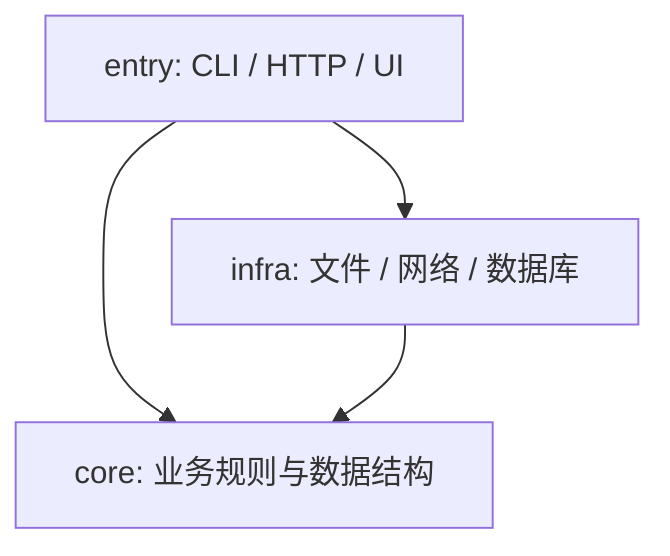

# <项目名> 架构说明

> 模板说明（落地时删除本段）：只写能被检查或能指导落点的内容；没有的部分写“无”，不凑篇幅。规则与 `.agents/architecture.toml` 保持一致，冲突时以本文件为准并同步修正配置。

## 1. 目标与档位

- **目标**：<一句话：这个项目解决什么问题、给谁用>
- **规模档位**：<一次性脚本 / 小工具 / 长期项目 / 多人多 Agent>；升档信号：<例如出现第二个入口>
- **不做的事**：<明确不引入的结构，例如“不使用 DI 容器”“不拆微服务”>

## 2. 分层与依赖方向

- 允许：<上层 → 下层列表>
- 禁止：<例如 core 不 import entry/infra；features 之间不互相 import>
- 由 <工具/配置> 强制：<import-linter 契约 id / dependency-cruiser 规则名 / CMake 目标 / arch_scan [[layers]]>

## 3. 目录职责

| 目录 | 职责 | 可以依赖 | 不放什么 |
|---|---|---|---|
| `src/<pkg>/entry/` | 参数解析、装配 | core, infra | 业务规则 |
| `src/<pkg>/core/` | 业务逻辑 | 标准库 | IO、框架代码 |
| `src/<pkg>/infra/` | 外部系统适配 | core | 业务规则 |
| `tests/` | 测试 | 全部 | 生产代码 |
| `<scratch 目录>` | 一次性脚本 | 任意 | 被正式代码 import 的内容 |

## 4. 新增 X 时放哪里

| 新增 | 放在 | 同时要做 |
|---|---|---|
| 新命令 / 子命令 | `entry/commands/<name>` | 在入口注册；补 CLI 测试 |
| 新业务规则 | `core/<领域>` | 纯函数单测 |
| 新外部系统 | `infra/<系统>`；需要替换时先在 core 定义端口 | 配置项 + 样例 |
| 新配置项 | `<配置模块>` 与 `config.example.*` | 写默认值与说明 |
| 新一次性脚本 | `<scratch 目录>` | 文件头写用途与日期 |
| 公共工具函数 | <唯一归属模块> | 先搜是否已有 |

## 5. 配置与密钥

- 加载入口：<模块与函数>；优先级：默认 < 文件 < 环境变量 < 命令行
- 配置样例：<路径>；真实配置位置：<路径，是否忽略入库>
- 密钥来源：<环境变量名或密钥管理>；不进源码、样例与日志

## 6. 入口清单

| 入口 | 命令 | 用途 |
|---|---|---|
| <cli> | `<命令>` | <用途> |

新增入口须在本表登记并说明为何现有入口放不下。

## 7. 检查命令

| 命令 | 检查内容 | 接入位置 |
|---|---|---|
| `<统一校验命令>` | 下列全部 | CI / 提交前 |
| `python <kit>/scripts/arch_scan.py` | 布局、硬编码、分层、循环 | 校验命令 |
| `<lint-imports / depcruise / cmake 目标>` | 依赖方向 | 校验命令 |
| `<测试命令>` | 行为 | 校验命令 |

## 8. 生成物

| 产物 | 来源 | 生成命令 | 位置 |
|---|---|---|---|
| <产物> | <源文件> | `<命令>` | <目录，是否入库> |

## 9. 决策记录索引

| 编号 | 标题 | 状态 | 日期 |
|---|---|---|---|
| ADR-0001 | <标题> | 已接受 | YYYY-MM-DD |
