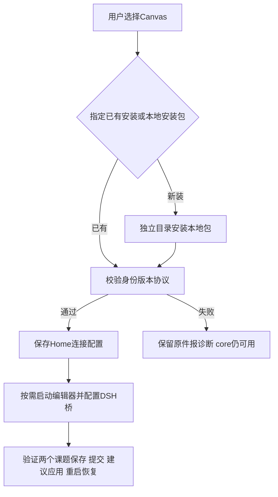

# AgentCanvas安装接入与课题资料分离

2026-10-18，L2。用户已确认先复用已有安装/打通新装，改包名，不公开npm、不推送；新增授权创建外部2T2R课题并迁入背景及流程资料，原件保留。

## 归属与接口

- AgentCanvas独立仓库 E:/Proj-2026-N05_AgentCanvas：包名@nefer5/agent-canvas、保持agent-canvas命令；提供机器可读 integration 信息及兼容嵌入协议声明，发布包含预构建dist与服务/CLI。版本独立，不发npm。
- optDSH packages/optdsh-bundle/lib/canvas-installation.mjs：发现显式root/标准安装/命令入口；校验本地程序、health身份及embed协议；按显式安装包准备独立安装目录，不修改全局PATH，不复制开发源码依赖。连接配置存Home/config/canvas.json。
- optDSH scripts/runtime：已有安装接入/全新本地包安装入口与按需启动；start-dsh在选择canvas时读取连接配置注入editorUrl，缺失/不兼容降级不阻断core。
- optDSH packaging/windows、安装验证：接通可选Canvas根/本地安装包；保留无canvas默认。安装成功与真实iframe握手分开验收。
- 课题 E:/Proj-2026-N06_2T2R-LiDAR：背景/术语/坐标约定、Study配置和适用Skill按来源映射复制，逐文件SHA256回读，原件不删除。历史run/商业模型不盲目迁移，保留来源入口。通用平台、光学能力不复制。
- docs/refactor/2026-10-18、STATUS、安装说明：当前实现、待做薄桥/通用文档统一、领域资料逐步剥离计划。正式实现不写本机路径。

## 任务

- [x] C1 独立Canvas包名与机器接入契约、本地包及回归（N05归属）。
- [x] C2 optDSH已有/新装发现配置启动，不同目录、端口冲突/不兼容拒绝等测试。
- [x] C3 2T2R外部目录背景/业务流程迁入及逐文件校验清单，源资料保留。
- [ ] C4 独立安装接入与真实页面握手/保存等验收，资料及配置不混入发布包。
- [ ] C5 文档、状态、版本、本地提交与工作日志；无推送/npm公开/真实模型/Zemax/沙箱。

## 未纳入本轮

独立Canvas统一通用文档服务及旧板完整迁移作为下一阶段，不把可用编辑器安装当作薄桥已完成；UI重设计先按根规则确认视觉专家，当前不改布局。外部研究资料从源码完全去除需引用解耦及公共领域包另行验收，本轮先建立可用外部课题并保留旧资料。

## 用户追加的去耦要求（同轮明确授权）

新开发版代码、活动配置、公共Skill不依赖旧optDSH根或任何具体课题。2T2R特定H/V、历史四die/双评价采用、面积/距离、对象号和研究模板归外部课题Skill；公共Skill读取当前workspace及显式配置。已调整baseline输出及preflight包发现，光学pilot支持配置声明的非空唯一源组（保留4源兼容）；native/custom当前双目标/global-z限制如实保留。公共两Skill版本0.3.0、光学包0.2.1；离线123测试和移出Skill目录的入口检查通过，真实Zemax未验。历史run字节不改；206份迁入原件/快照哈希一致。

C4阶段：两条安装路径和Windows5.1真实启动、iframe握手、外部课题绘图保存/重启回读已通过。完整147插件/66安装/11PPT/123光学/37分发/56架构kit通过；一次存储夹具Windows EPERM瞬时失败重跑通过，原日志保留。没有真实模型提交/建议生成验证，不把离线流程当真实Agent验收。
