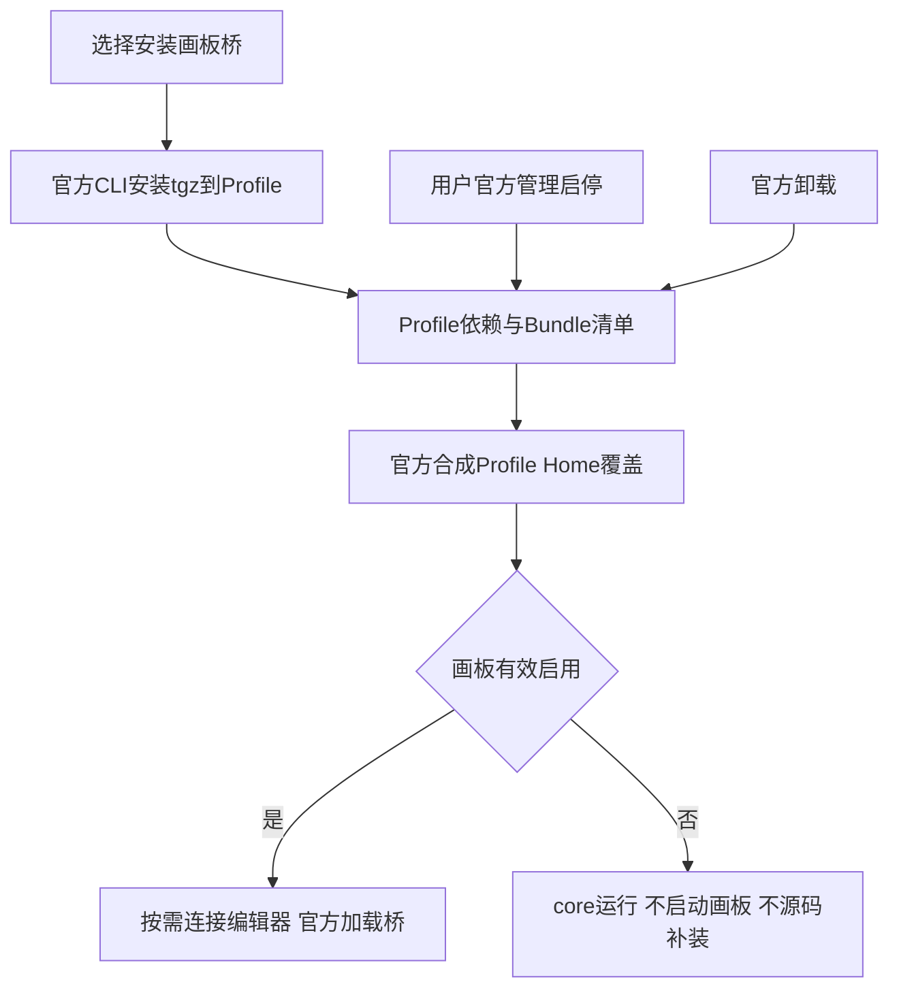

# 画板桥统一官方Profile生命周期

2026-10-18 L2。用户确认从canvas先收敛；plugins是源码区，安装副本在选定Home/Profile；不公开npm、不推送。先方案再执行，沿用用户授权，无UI改版。

## 落点

- packages/optdsh-bundle/lib/profile-components.mjs：复用官方dsh-app-boot读取有效Bundle/Profile/Home patch；返回canvas未安装/未选/disabled/选中/不兼容，保留官方状态为事实源。无自造启停数据库。
- compose.mjs、index.js、cli.mjs：Canvas不再app源码fallback/insert/force启用；components仅安装意愿，不决定已安装Canvas运行开关。Bundle给推荐组合和默认配置，状态跟随Profile有效条目。
- scripts/runtime/start-dsh.ps1：只在官方Canvas有效启用时校验/按需启动独立编辑器；停用/卸载后不拉起。必要编辑器异常隔离只关闭对应已启用桥，不覆盖用户停用。
- plugins/optdsh-agent-canvas/lib/index.js及config helper：从Home运行环境读取连接默认，Profile的显式配置优先；不依赖Bundle源码，不改画板数据格式。
- packaging/windows/install.ps1与install-profile-component.ps1：canvas tarball为发行库存；核心app dependencies不再含它，通过官方Profile CLI显式安装/升级；已安装默认保留，不反复重放选择。卸载按官方管理机制，保留课题画板与编辑器用户资料。
- 根package workspaces及bundle package依赖：源码保留plugins，canvas不再隐式workspace安装；依赖声明官方dsh-app-boot，npm按manifest管理安装树，不手改node_modules。
- tests/installation：配置优先级/安装路径/无回流专项；真实隔离Profile做官方RPC停用/启用/重启、离线tgz升级和卸载。
- docs/installation、architecture、STATUS、handoff、refactor决定：目录示意、开发pack/install步骤、官方升级需要停服的边界；本地版本与构建追踪。

## 任务

- [x] P1 核对官方包管理/有效配置API；明确源码与安装目录。
- [x] P2 Canvas Profile状态/装配/配置实现，去app副本及components强启用。
- [x] P3 总安装器和显式升级入口，保留已有停用与用户数据。
- [ ] P4 夹具与完整回归，真实Profile启停/升级/卸载/重启无回流、无模型请求。
- [ ] P5 日常预览迁入Profile、独立测试包、文档/日志、本地提交，无推送。

## 约束

只先改画板桥生命周期；其他自有插件列为后续，不谎报全量已统一。独立编辑器与Profile桥不同生命周期；停用桥不杀共享编辑器。旧OptDSH/全局.agents不改，研究画板不移动/删除。不支持在线原位升级时用官方停服CLI add新tgz并验证用户停用不被重置。旧运行包、许可证与正式公开发布不在本轮。

P4实测：官方listBundles显示availability=profile/removable=true；entry启停和bundle停用、停服升级0.6.1测试夹具、卸载均走官方接口，操作application=applied。disabled重启仍off且不拉编辑器，升级后Bundle未选及单entry disabled均保留，卸载重启后not-installed；课题文件哈希不变。无模型请求。旧config/dsh.local-policy的Canvas源码挂载也已移除。完整回归147插件/81安装/11PPT/123光学/37分发/56架构kit通过；最终补充20项定向通过。
