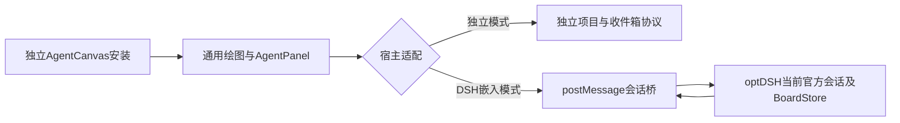

# DSH复用独立AgentCanvas界面与安装

2026-10-18；L2，涉及独立编辑器的宿主适配与optDSH桥公开消息。用户要求沿用全局画板已有界面，不调用视觉专家。用户已明确授权同时修改N05嵌入模式、验证后更新本机运行包与DSH接入；保留资料并做好回退，不公开发布。

## 实际现状与目标

- 全局编辑器与DSH验证编辑器都是0.2.3，dist/index.html哈希相同；区别来自EmbeddedCanvas独立精简UI，不能仅换端口解决。
- DSH当前指向validation/manual-preview/canvas-editor下安装副本；目标接入全局已安装程序，升级由独立画板维护，DSH不复制整套UI。
- 独立App和嵌入模式共用AgentPanel外观/字段/样式，编辑器负责呈现；DSH桥仅给会话、workspace、版本、状态及保存/提交/提案操作。
- 共享编辑器安装不等于共享提交队列。DSH仍沿当前官方会话/BoardStore，不能把提交改投独立inbox，也不能把编辑器握手说成Agent正在处理。
- 全局程序部署前保留原运行包及入口回退信息；不删独立板、DSH板、浏览器恢复副本，不改真实模型。

## 文件落点与验证

| 所属 | 预计落点 | 职责/验收 |
|---|---|---|
| N05 | src/components/AgentPanel.tsx | 复用原右栏，支持宿主状态文案/只读/历史入口；独立模式原行为不变 |
| N05 | src/EmbeddedCanvas.tsx、embedded.css | 使用共享面板，保留绘图、说明、建议预览/拒绝与草稿保护；无独立inbox调用 |
| N05 | 组件/嵌入测试、integration-info与运行包 | 源码/构建标识、兼容能力；独立/嵌入双路径测试、预构建本地包与回退 |
| optDSH | plugins/optdsh-agent-canvas/lib、web/transport.js | 消息只增加必要workspace/状态元数据；固定session身份；保留revision/提交幂等与历史只读 |
| optDSH | packages/optdsh-bundle/lib/canvas-installation.mjs | 已有安装接入与身份/兼容校验；不自动覆盖用户选择或恢复禁用插件 |
| 本机接入 | Home/config/canvas.json、AgentCanvas安装运行包 | 显式接入统一程序，兼容服务复用，不误杀共享进程或移动画板资料 |
| 文档 | docs/installation/canvas.md、planning/STATUS.md | 真实版本/部署/回退状态；明确界面复用与通用文档协议仍是不同里程碑 |

1. 原SDK故障单独收尾：Canvas0.6.2 peer修复已实装；原失败会话官方工具与Forms完成、113项相关回归通过。
2. 跨仓授权后核对N05现有工作树；新改动与原改动隔离，先组件复用与宿主契约，再本地构建。
3. 不触及真实画板内容，使用合成会话验证加载/保存/重开/说明/提交归属/提案拒绝/历史只读/错误恢复。
4. 独立模式检查原右栏、CLI和现有数据；DSH同一安装里检查右栏一致、真实workspace与会话、状态不误报。
5. 浏览器实际渲染并查看截图，哈希/安装身份回读；文档、版本和共享日志随最终结果更新。

不把完整跨宿主文档权威迁移偷偷并入UI任务：若实现需要变更独立持久化协议，先明确迁移范围与回退，不双写两份权威。
## 执行清单

- [x] C1 共享AgentPanel/连接诊断、宿主语义与只读边界。
- [x] C2 DSH元数据与历史桥接；去除重复状态壳。
- [x] C3 双路径组件/协议/安装测试、独立本地运行包。
- [x] C4 合成会话浏览器视觉与保存/重开/历史/提案验证。
- [x] C5 备份与数据哈希后更新统一安装，DSH接入及回退说明。
- [x] C6 版本、架构说明、开发/发布/运行分离文档及共享日志。
