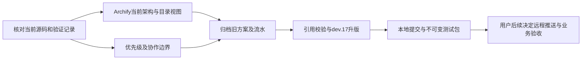

# 当前架构、文档归档与dev.17

用户授权：重画当前架构、归档过时文档、梳理剩余优先级和升级版本；本轮本地提交/测试包，后续追加授权完成后正常推送codex/platform-dev到原GitHub远程，不强推、不合主分支、不正式发布，不动运行服务或Zemax。视觉选择：不调用专家，由主Agent使用Archify。

L2：文档归档、跨目录引用及发行文档入口共同变化，不新增产品运行接口。

- [x] D1：以5d6920e固定运行源码；docs/architecture当前视图及目录、源码证据；Archify finalize和实际看图。
- [x] D2：planning/ROADMAP唯一优先级/用户配合清单，STATUS仅当前摘要。
- [x] D3：docs/archive内ZIP+SHA清单；提取仍有效的决定、安装和验证文档，旧入口转向当前页；不改历史运行原件。
- [x] D4：统一dev.17，发行携带当前文档而非历史流水；链接/版本/必要回归；本地提交及测试包。
- [x] D5：浏览器查看、共享工作日志与正常开发分支推送；不强推、不合主分支、不正式发布、不动全局环境或模型。

归档前检查目标在本仓docs/archive，逐文件哈希回读；原件可恢复回收，使用safe-delete。仅处理本任务明确盘点的文档和已退役的旧工作簿生成脚本。

源码检查：完整npm test、版本一致性、文档链接、181项ZIP逐文件哈希、三图各四项自动门禁通过；三图与合并页面已实际看图。发行产物验证和远端SHA留收尾回执，不提前标记。

本地测试包：releases/0.2.0-dev.17，源提交33a7fe4；全部构建哈希、三张图和包内浏览器加载通过。v0.2.0-dev.17为本地标签，标签/Release未推送。

初次推送回读：codex/platform-dev = dc2c120ce8ee1754da2f07540be473aa1db74fec，main = 7b36ceb34273f07cebedeceeb01578fb1c8babaf；正常新增开发分支，未强推、未推送标签、未创建Release。共享日志在最终远端SHA复核后追加。
