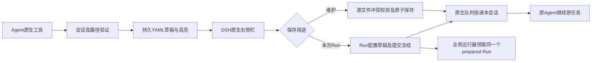

# Forms原生会话YAML编辑器

日期2026-10-18；L2。用户明确授权正式实现，视觉原型已确认：右侧栏与聊天同时可见，不是弹窗。Forms随optDSH交付，不作独立产品或额外MCP。用户此前已选视觉专家，沿用已确认方向。

## 已确认交互与职责

- 固定通用渲染器，一份YAML一页完整配置；字段路径高亮仅为界面元数据；保留并展示注释，注释参数不自动启用。
- 可增删键、值及数组行；维护模式原地修改明确来源，运行模式配置归当前workspace下本次Run。
- Agent通过原生forms_open_yaml发起；forms_focus更新重点，forms_read读取回执。随包dsh-forms/Rx技能提供发现及流程，不依赖旧聊天。
- 不新增常驻顶栏按钮；当前会话工具卡片可重开，原生sidebarRight自动打开。提交使用官方会话队列，重复点击不重复投递，无法确认交付时不自动重发。
- 维护保存检查源文件哈希；历史Run不覆盖。Run配置提交后冻结；执行器领取prepared Run，避免配置与实际运行目录错位。
- 新文档按官方session.cwd隔离；来源限定workspace与可信配置资源根，浏览器不提供任意文件路径。不启用Zemax或追迹。
- 用户追加幂等要求：同会话/来源/用途复用编辑文档及Run草稿；无变化编辑/重复打开保存提交不增生YAML/JSON/Run或重复投递。仅明确新任务/冻结后重跑新建；维护基线备份每文档一份。增加文件/Run/投递计数及重载恢复测试。

## 落点与验收

- [x] F1 plugins/optdsh-forms/lib/yaml-document.js、editor-store.js：语法树、注释、路径、修订、沙盘/真实目标、维护/Run保存；结构、别名/特殊类型、精度、冲突、路径逃逸、原子写入、Run冻结测试。
- [x] F2 lib/editor-runtime.js、index.js：原生工具/会话路由、短引导、API鉴权、投递状态；精确Agent、双workspace、错误/重复/重载测试。
- [x] F3 lib/client.js与web/yaml-*：真实sidebarRight和会话卡片、固定编辑器；不增标题栏按钮，保留Study旧接口。浏览器检查完整字段/灰注释/高亮不丢输入/结构编辑/保存/提交回本会话。
- [x] F4 packages/optics/run_bundle.py、Rx Skill：prepared Run领取与哈希门禁，默认样例演示只用隔离副本，不改真实模型；运行包离线验证。
- [x] F5 Profile与随包发现：Forms归官方Profile，包内含产品Skill；卸载撤工具/引导/客户端，启动不复活，基础平台可用。
- [x] F6 版本/文档/测试包及开发预览：专项/完整必要检查，Rx YAML在无旧聊天会话中发现及实际工具调用（不连接Zemax），维护/Run双路径回执，用户手工入口和共享日志（收尾回执独立记录）。

实现先在隔离验证目录运行，再显式升级开发预览Profile；不改全局.agents、不动旧现场或商业模型。保存/编辑配置不新增任何Zemax执行授权。沿既有本地提交和开发分支推送授权，不公开npm或正式Release。
