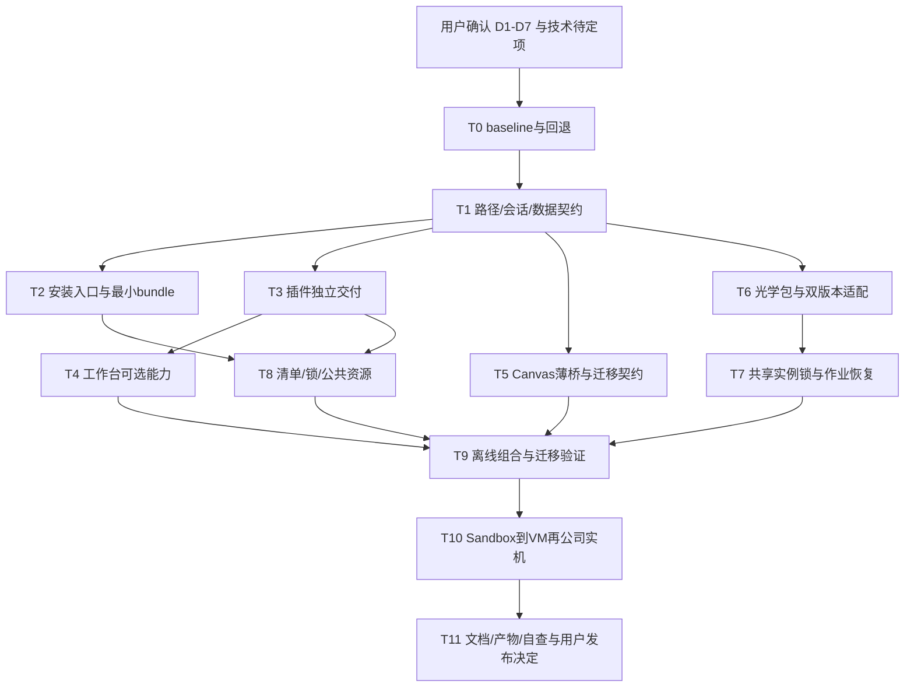
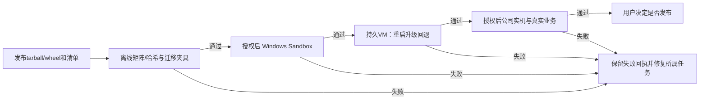
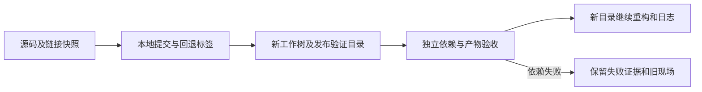

# 计划：平台独立安装与可选插件重构

- **日期**：2026-10-18。
- **级别**：L2；安装入口、公共协议、多个模块与迁移数据边界均改变。
- **状态**：**已授权实施**。用户已确认Q1–Q5、暂缓沙箱，其余按推荐方式实施；分支 codex/platform-plugin-refactor。
- **设计摘要**：[目标架构](../../docs/refactor/2026-10-18/design.md)。
- **决定入口**：[已确认方向与待定项](../../docs/refactor/2026-10-18/decisions.md)。
- **本轮允许范围**：允许本仓产品实现、合成数据测试和隔离打包。保留Study/run与活跃资料，暂不迁移切换、重启现役服务、修改邻接项目/全局工具、执行真实光学/模型/沙箱、发布或推送。

- **已确认选择Q1**：optDSH独立一套用户资料目录，所有光学课题共用；与普通DSH隔离，具体路径和迁入流程待定。其余决定现已确认，见 decisions.md；实际迁移切换仍需停写窗口。

## 目标与落点总览

用户安装一次官方 DSH＋所选 optDSH 组件，即可在任意研究目录工作；插件可单独安装、升级、停用，发布包可在干净 Windows 环境重放。官方 loop/profile/会话格式保留，Canvas 通用文档唯一，光学实例访问受统一门禁与共享锁管理。

拟复用 `plugins/*`、`packages/optics`、`scripts/runtime`、就近 tests 和现有运行包逻辑；拟新增 `packages/optdsh-bundle`（产品组装）、`packaging/windows`（发布生命周期）及 `tests/installation`（跨包产物验收）。新增目录与字段均是设计提议，确认前不创建实现。运行核心不导入 Study、宿主 UI 或私人中心；UI/CLI 只做装配和协议适配。

## 复用能力与工具优先级

2026-10-18 读取共享环境正式记录及当前源码。以下是证据范围，历史能力未在本轮重放，不当作重构后验收结果。

| 优先级 | 工具/方法 | 已验证能力与范围 | 条件与限制 | 可替换备选 |
|---|---|---|---|---|
| 高：已有实现 | 官方 sessionController / Profile / Cordis bundle | 当前源码使用官方会话；既有读图调研核对固定版 profile/bundle 机制 | 保持固定版，实施前核对真实 schema；不套用 master 新能力 | 官方升级仅作为另一次兼容验证 |
| 高：已有实现 | optics run/reporting、身份/revision、保存回执 | 现役源码及历史独立副本/保存证据存在 | 不是新包/19版/新机通过；不删失败/uncertain门禁 | 版本适配器可依现场实测调整 |
| 高：历史实测 | Windows PowerShell 5.1/.NET Framework 19版入口 | 共享 tools.md 2026-10-05：DLL加载与只读版本/文件回读 | 项目 Python 当时失败；追迹、写入、双版共存未验 | 单独进程适配；不强迫统一运行时 |
| 高：历史实测 | 独立 Canvas 安装器/编辑器与现有嵌入 transport | 既有调研有独立交付路径；当前 DSH transport、回执和 revision 有实现 | 不证明通用文档已独立；外部修改需明确范围 | 对现有协议增量扩展或公共核心方案待选 |
| 高：已有资产 | expert-distribute 与公共 Skill | 中心分发有历史校验；项目存在链接与生成入口 | 私人中心不是产品依赖；公共包需白名单和断链验证 | 构建期导出公共资源，无需终端中心 |
| 高：图示交付 | Archify＋浏览器检查 | 前次图保留 candidate/HTML/finalize/browser-check；共享记录有真实工具校验 | 图通过不代表设计或产品功能通过；不自动装升级 | Mermaid 始终维护计划流程权威 |
| 候选，未实测 | Windows Sandbox → 持久 VM → 公司实机 | 前次调研只有系统条件探测，未完成 Sandbox 产品安装 | 启用系统功能、安装、真实业务需具体授权；不能代替公司验收 | 按机器能力选择可回退 VM或独立测试机 |

| Agent/宿主 | 已验证能力与范围 | 依赖 | 尚未验证 |
|---|---|---|---|
| 开发 Agent / Codex | 本轮读取源码、写设计与计划文本 | 当前项目文档、Shell与文件工具 | 新产品安装、模型/光学运行均未做 |
| 官方 DSH / Standard | 历史会话与工具闭环有既有证据 | 固定 DSH、选定模型、profile | 新全局安装、多 workspace、独立插件产物 |
| 独立 Canvas 产品 | 历史独立编辑器/安装路径 | 独立版本及嵌入协议 | 唯一通用文档服务、迁移协议与回退 |
| 光学执行器 | 现役包/历史2025样本；19只读入口的独立证据 | 实际许可证、目标版本DLL及实例 | 19完整业务、双版本新包、新机数值一致性 |

## 架构与任务依赖（目标，未实施）

ROADMAP 维护固定 M 编号五列，任务状态以本计划为准；本计划不以图示完成勾选产品任务。各阶段提交评审记录，失败回到对应任务；不自动通过更换模型、放宽门禁或安装全局依赖掩盖失败。

## 实施任务

以下文件是确认后拟落点，T1 冻结后若有改名/新增须先更新本计划。每项可独立检查与回退；外部 Canvas 实施、真实模型/Zemax与系统启用需具体授权。命令名中“拟”表示当前没有实现，不可报告为已执行。

### T0 基线、数据盘点与可回退点

- **文件落点**：拟 `scripts/maintenance/migrate-user-data.mjs`、`tests/installation/migration.test.mjs`；私有证据写 `.backup/platform-plugin-refactor/<批次>/`（不提交），普通开发输出 `temp/refactor-planning-20261018/`。
- **接口**：`inventory(sourceRoots) -> {paths, hashes, kinds, excluded}`；`migrationPlan(sourceRoots, targetRoots) -> Mapping`，默认 dry-run。
- **行为**：记录 HEAD 和未提交 diff、reparse/link目标、官方 profile 与启停/豁免选择；对数据原件建可恢复副本。raw credentials只在用户本机授权备份，不进入公开报告。历史 run 整包只读，不启停服务、不抢锁。
- **验证**：在合成夹具执行盘点/复制/哈希；模拟中文路径、重名、链接、读取失败与中断重试。进入真实迁移前由用户确认范围与停写窗口，备份恢复演练通过。
- **回退**：本任务不改源数据；无法完整盘点则停止后续迁移。
- **阶段状态**：源码分支与基线快照已建立；复制迁移器4项夹具通过；真实资料盘点/备份/恢复/切换未做。
- **全部完成**：[ ]。

### T1 路径、会话、数据与请求契约冻结

- **文件落点**：`scripts/runtime/` 下拟 `launch-config.ps1`；`docs/contracts.md`、`docs/runtime.md`、`config/` 下拟 `runtime.example.json`；单元夹具在 `tests/installation/paths.test.mjs`。
- **接口**：`resolveLaunch({installRoot,dshHome,profile,workspaceRoot,stateRoot}) -> LaunchContext`；官方 `inspect(sessionId) -> meta.cwd` 直接复用；请求签名见 design.md 第4节。
- **行为**：五根职责分离；配置优先级明确；缺省普通研究不要求 study.yaml。认证状态和请求回执不得混同课题配置。
- **验证**：拟配置解析测试＋只读安装目录/两个 workspace/路径空格与中文/相对路径/越界拒绝；同 ID 不同内容返回冲突，不重放 uncertain。
- **回退**：保留旧配置入口兼容转换，转换不写回旧配置；无法解释路径时明确报错。
- **阶段状态**：五根与配置优先级、profile/进程归属契约已落地；自定义profile真实启动通过。Canvas独立文档协议仍属T5。
- **全部完成**：[ ]。

### T2 薄安装入口与官方最小 bundle

- **文件落点**：`scripts/runtime/start-dsh.ps1`、`open-dsh.ps1`、`status-dsh.ps1`、`stop-dsh.ps1`、`scripts/setup.ps1`；拟 `packages/optdsh-bundle/{package.json,cordis.patch.yml,README.md,LICENSE}`；根 `package.json` 的 workspace/构建声明与相应依赖锁（将新组装包纳入开发构建）；拟 `packaging/windows/install.ps1`、`uninstall.ps1`。
- **接口**：薄启动参数 `-Home -Profile -Workspace`（拟）；bundle 使用官方 `dsh.bundle.patch`；实际参数语义核对固定 DSH 后冻结。
- **行为**：纯平台不需要 Python、N05或私人专家分发器；由官方 loop 和 profile 加载。安装/卸载仅操作安装器拥有文件，用户数据默认保留；删除走可恢复流程。
- **验证**：基于打包产物、无源码 checkout 启动最小 profile；假服务验证身份/PID回收与冲突门禁；不请求真实模型。安装根替换不改变 home/workspace。
- **回退**：保留旧启动入口与原 data，切换前后分别指定 home，禁止两个版本同时写同数据。
- **阶段状态**：薄启动、core Bundle、本地产物安装器已实现；新版默认/自定义Profile启停与仓库外安装通过。用户PATH注册为显式选项，未修改本机PATH；卸载只预览未实际回收。
- **全部完成**：[ ]。

### T3 自有插件的独立包契约

- **文件落点**：`plugins/optdsh-{workbench,agent-canvas,forms,experts,current-info-policy}/package.json`、各包拟 `cordis.patch.yml`、`README.md`、`LICENSE`/`NOTICE.md` 与原包测试；`config/dsh.local-policy.yml`。
- **接口**：各包声明 exports、files、宿主兼容范围、包内默认配置与 bundle patch；正式名称/许可证待确认。
- **行为**：删除宿主仓库 package.json/config 的隐式读取；自有资源按包定位，用户配置经注入。官方依赖声明完整，不通过修改 node_modules 解决适配。
- **验证**：逐包 `npm pack --dry-run --json` 检查白名单，再实际生成 tarball（需实施授权）并在独立 profile 安装；离开仓库后加载。检查LICENSE、第三方资源、缺配置和版本不兼容报错。
- **回退**：逐包保留上一个产物与兼容配置，不同时更改所有插件数据格式。
- **阶段状态**：六个npm产物可打包，三业务插件声明与资源通过新版测试；许可证/公共专家完整资源和正式发布尚待完成。
- **全部完成**：[ ]。

### T4 工作台独装、会话 cwd 与可选能力

- **文件落点**：`plugins/optdsh-workbench/lib/index.js`、`web/workbench-agent.js`、`web/workbench.html`、已有 `web/optics-api.js` 与包内测试；Forms 的 `lib/store.js`及相应测试按实际目录读取更新。
- **接口**：`capabilities() -> {canvas,forms,optics}`；`bind(sessionId,workspaceRoot,target?)` 以官方 cwd 校验，不创建新会话库。
- **行为**：移除 Canvas 静态主链依赖，按需加载及 origin 配置；可选组件缺失仅影响对应入口。已有研究会话可绑定，模型身份/revision/权限门禁保留；UI改动前沿用用户对视觉专家的当次选择，未选时依根规则询问。
- **验证**：DOM/模块图测试工作台无 Canvas/Forms、缺光学后端、两个 cwd、旧引用拒绝、可选能力恢复；后续真实浏览器交互按隔离验收执行。
- **回退**：不改写历史消息；绑定映射可恢复，保留旧版本兼容读取。
- **阶段状态**：会话cwd、可选Canvas动态加载和Forms降级已实现；新版API/客户端加载图/脚本下载通过，真实React挂载和编辑器握手未验。
- **全部完成**：[ ]。

### T5 Canvas 文档边界、薄桥与数据兼容

- **文件落点**：`plugins/optdsh-agent-canvas/lib/{index,boards,tools,drawing,client}.js`、`web/transport.js`、包内 tests；拟 `scripts/maintenance/migrate-canvas.mjs`。独立 Canvas 的实现文件由其项目勘察后另列，不在本仓计划中虚构或直接修改。
- **接口**：`bindCanvas/submitCanvas` 见设计；拟 `exportLegacyBoard(input) -> Export`、`importDocument(export,mapping) -> Receipt`；协议版本、origin、文档存储待确认。
- **行为**：独立 Canvas 拥有通用文档，桥留绑定/认证/投递回执；旧 boardId/session/revision、快照、建议、拒绝、附件、冲突恢复和 uncertain 全部保留。没有外部实现授权/协议验收时只完成兼容契约，不宣称薄桥完成。
- **验证**：离线旧数据夹具→导出→导入→核对语义与附件哈希；多窗口冲突、重复投递、断线、不确定恢复、保存不自动发送、用户应用才改原稿；独立安装无 DSH 与仅 DSH 桥两方向测试。
- **回退**：只复制迁移；单一写入权；新数据逆向导出读回验证后才回切，失败保留双侧原件待人工处理。
- **阶段状态**：课题就近保存与旧板冲突保护已实现；N05独立模式和DSH embed尚未统一通用文档协议，薄桥/完整迁移未完成。
- **全部完成**：[ ]。

### T6 光学可安装包与18/2023+运行时适配

- **文件落点**：`packages/optics/pyproject.toml`；将现有 `scripts/{server,mcp,worker,tx-native-worker}.py` 入口纳入 `src/optdsh_optics/`（具体模块名在实现前冻结）；`service.py`、`tx_jobs.py`、`connection.py`、包内 tests；`scripts/runtime/start-optics.ps1`。
- **接口**：拟 console scripts `optdsh-optics serve|mcp|worker --config --workspace --state-root --target`；18适配协议按预研冻结，不提前新增多层工厂。
- **行为**：消除根 AGENTS/package.json 发现、仓库 scripts 路径和固定 Study；服务/worker消费冻结配置。18/2023+显式版本和实例回读，DLL独立进程；已失败 Python 路线不得伪装兼容。
- **验证**：wheel 安装到全新隔离环境，在仓库外合成运行；缺 DLL、版本不符、runtime失败拒绝且不自动降级；18先获具体授权做只读，真实副本追迹/保存分别另验。未具授权时用fixture验证协议，不标真实通过。
- **回退**：旧版执行器环境保留；每次作业冻结代码/包版本与配置，失败不自动重试真实写入。
- **阶段状态**：0.2.0 wheel命令入口及配置注入已实现，干净venv的无依赖合成边界通过；完整依赖下载未通过，18专用桥未实现，2023+真实业务未验。
- **全部完成**：[ ]。

### T7 共享实例锁、作业状态与恢复

- **文件落点**：`packages/optics/src/optdsh_optics/{connection,service,tx_jobs,model_save}.py`，拟 `instance_lock.py`，已有作业/锁测试及跨进程 tests。
- **接口**：`acquireInstance(target,owner,requestId) -> Lease`、`recoverJob(jobId) -> KnownOrUncertain`；锁文件路径由 state root注入。
- **行为**：真实实例身份而非课题锁；CLI与DSH共享锁；PID/启动时间/token防误释放。刷新/保存/分析共用宿主忙检查；Agent取消、作业取消、已清理分别记录。
- **验证**：两个进程两个 workspace 竞争同实例只一个成功；不同模拟实例不误阻断；崩溃、进程复用、状态丢失、恢复失败与uncertain保留；真实跨版本/实例并发需另外授权。
- **回退**：无法确认锁所有者或清理状态时拒绝操作，保留审计，用户处理；不以删锁让测试变绿。
- **阶段状态**：每用户LOCALAPPDATA/optDSH/locks跨Home/课题互斥和uncertain门禁已实现，111项光学离线测试含跨进程通过；真实并发/取消清理仍待验。
- **全部完成**：[ ]。

### T8 发布清单、profile锁与公共资源

- **文件落点**：拟 `packaging/windows/release-manifest.example.yaml`、`plugins.example.yaml`、`scripts/maintenance/export-release.mjs`；`.agents/development-skills/expert-distribute/` 仅按既有中心边界调用，不修改中心；相关包 README及安装测试。
- **接口**：`planInstall(selection,existingProfile) -> Diff`、`verifyRelease(manifest,files) -> Findings`；schema版本、顺序、完整性和启停字段在本任务冻结。
- **行为**：根依赖锁和profile锁分开；精确组件版本/哈希、选择的启停/顺序、已确认豁免可重放；用户覆盖层保留。公共 Skill/专家白名单构建，不含私人中心偏好/截图/凭据/本机fleet，终端不要求中心目录。
- **验证**：在不挂载开发者用户目录环境安装；缺资源/断链接/额外敏感文件失败；第三方peer拒绝、disabled不启用、配置合并和中断恢复；联网/离线/Node随包分支按最终决定验收。
- **回退**：安装前保存profile选择/锁/用户覆盖层；失败回滚已拥有产物，不覆盖会话和用户文档。
- **阶段状态**：组件哈希、构建锁与11项市场选择快照及保守重放脚本已交付；正式profile锁/市场全组合重放/公共专家资源发行未完成。
- **全部完成**：[ ]。

### T9 离线组合与迁移演练

- **文件落点**：拟 `tests/installation/{matrix,migration,workspace,uninstall}.test.mjs`、`scripts/maintenance/migrate-user-data.mjs`，既有模块测试入口；验收证据写 `runs/install/<批次>/`（私有输入不提交）。
- **接口**：`runCase(release,selection,workspaceRoots) -> InstallationReceipt`；`verifyMigration(mapping) -> HashAndSemanticReport`。
- **行为**：只使用发布包而非workspace链接；旧官方session/profile格式保留，迁移按哈希/路径映射/附件与语义读回。进程token重新生成；真实数据迁移前确认停写窗口。
- **验证**：下表全部必过用合成数据离线自动化；迁移中断/重入、路径不存在、附件缺失、新版写入后回退、用户数据卸载保留；按变更运行 `npm test` 与项目check，真实模型/Zemax仍排除。
- **回退**：逐组件/逐数据域恢复，旧源未改；新版本新增数据无法兼容时停止回退并给人工方案。
- **阶段状态**：23项安装/路径/归属/复制迁移/产物篡改测试通过，仓库外包加载通过；真实资料与新写入回退、浏览器矩阵未完成。
- **全部完成**：[ ]。

### T10 Windows隔离安装与公司验收（用户明确暂缓）

详细方案与本机只读状态见[Windows沙箱与换机安装验证](../../docs/refactor/2026-10-18/windows-validation.md)。该目标已由用户明确提出；本轮仅补文档，没有启用系统功能或运行guest安装。

- **文件落点**：拟 `tests/installation/windows/{smoke.wsb,bootstrap.ps1,vm-checklist.md,company-checklist.md}`；拟 `docs/installation/windows-testing.md`；`runs/install/<批次>/`保留清单、日志和失败证据。
- **接口**：测试入口接受发布包根与结果导出根，不读取宿主私人 home；Sandbox/VM自身 localhost 与宿主分开。
- **提前接入**：T2/T3形成最小发布产物后即建立Sandbox基线；安装入口、依赖或插件组合变化时重放相关用例。T10是完整验收收口，不等到最后才第一次换环境测试。
- **Sandbox用例**：按文档S1–S9覆盖缺依赖、纯平台、工作台单装、画板单装、共同安装、两个外部目录、中断/重复、离线变体和关闭后重新复现。只有明确交付离线变体时才将离线成功列为必须通过，否则明确标不支持。
- **guest/host边界**：只读映射真实发布物、专用目录导出证据；依赖在guest内安装或由发布包明确携带。不得借用宿主node_modules、私人中心、缓存、凭据或已运行的服务获得假通过。
- **行为**：先只读检测系统条件；用户明确启用Sandbox/Hyper-V或安装VM后才操作；Sandbox干净临时安装→持久VM重启/升级/回退→公司实机目标runtime/网络/模型出口/许可证/业务逐层验收。
- **验证**：按矩阵记录“产物存在/依赖安装/登记/加载/交互/业务”不同证据。模型请求、Zemax读写/追迹、公司数据和网络仅在具体任务授权范围运行；失败不切备用掩盖。
- **回退**：测试VM快照恢复；沙箱结果显式导出后关闭；不影响宿主运行服务与研究文件。
- **分层通过标准**：包/哈希正确、依赖检查、登记/加载、实际界面和synthetic分别记录；普通用户权限、长期升级与旧版环境进入VM；公司出口/许可证/真实业务进入公司实机。每层未测项单列，不用图稿或宿主运行替代。
- **阶段状态**：用户明确暂缓；未启用或运行Sandbox/VM/公司测试。
- **全部完成**：[ ]。

### T11 发布说明、图示、复核与用户发布决定

- **文件落点**：`README.md`、`docs/{architecture,runtime,agents}.md`、`planning/{STATUS,ROADMAP}.md`、`推荐插件.md`；拟 `docs/installation/` 与各包独立说明、`docs/architecture/`中的Archify源/HTML/回执；检查复用现有maintenance入口。
- **接口**：发布入口链接 release manifest、组件许可证、版本兼容矩阵、离线安装、workspace/可选插件、凭据注入、迁移回退、排障与验收回执。
- **验证**：按已确认落点和依赖方向自查；用户需要独立体检时另用arch-review，不能把自查标成独立审查。图核对分支/裁切/字号/失败回退及待开发状态；安装包内离线链接能打开；需要提交时pre-commit只检查真实暂存区一次。
- **完成条件**：任务证据与ROADMAP一致；所有未验项明确；只有用户明确授权后才提交/发布/推送，计划确认不包含该授权。
- **阶段状态**：决定、设计、实施摘要、门户和离线包入口已同步；Archify图保留重构前/目标版本，非全部目标已实现证明；未提交/公开发布/推送。
- **全部完成**：[ ]。

## 安装组合与验证等级

| 用例 | 选择/条件 | 必须证明 | 验收层级 |
|---|---|---|---|
| I1 | 官方平台＋最小bundle | 无Python/Canvas/私人中心仍可启动并打开普通会话 | 产物/离线＋Sandbox |
| I2 | 工作台＋光学执行器；无Canvas/Forms | 页面和会话正常；合成快照明确synthetic；缺后端真实报错 | 模块/产物＋Sandbox |
| I3 | 独立Canvas＋DSH薄桥；无光学 | 创建、保存、提交、建议/拒绝/应用与重连回执 | 离线协议＋Sandbox/VM |
| I4 | 工作台＋Canvas；Forms未装/后装 | 可选入口探测，互不阻断且文档唯一 | 产物＋Sandbox/VM |
| I5 | 两外部workspace，中文与空格路径 | session cwd正确、配置/文档/run隔离；同实例互斥 | 离线跨进程＋VM |
| I6 | 推荐市场插件固定版本＋disabled项 | 锁、顺序、启停重放；peer拒绝不自动豁免 | 产物/受限网络＋VM |
| I7 | 专家/Skill/PPT选装，无个人中心 | 资源随包，不泄露私人文件，不成为纯平台前置 | 白名单＋产物 |
| I8 | 升级/卸载/重启/回退/迁移中断 | 官方会话、Canvas历史、恢复快照、run和新增数据不丢 | 持久VM |
| I9 | Zemax18 / Zemax2023+ | 先真实版本/模型只读，再按授权分副本、保存和数值验收 | 持久VM或测试机＋公司实机 |
| I10 | 公司网络/权限/许可证/出口限制 | 所选模型与插件源可访问，安装及真实业务证据可回查 | 公司实机；不由Sandbox替代 |

I9的具体业务等级、I7 PPT首版范围、离线runtime随包与跨Windows用户并发仍待用户确认；表格要求不等于授权本轮执行。

## 确认与进度规则

当前已获实施授权，T0源码快照已建立；数据迁移尚未执行。路径、Canvas存储、仓库策略、运行时外置、许可证、目标业务支持等级见 decisions.md。主会话每阶段在既有 ROADMAP 固定表增量更新，不因文档/图完成标功能完成；实施者逐项记录已运行检查与证据路径。失败重试、锁不明、回退不兼容转人工；本方案不增加后台定时复盘或自动模型续轮。

## 变更记录

| 日期 | 变更 | 原因 |
|---|---|---|
| 2026-10-18 | 新增L2待确认草案，T0-T11全部未开始 | 用户授权沉淀讨论、目标架构与重构计划；不授权代码实施 |
| 2026-10-18 | Q1确认：optDSH独立资料目录，所有光学课题共用 | 用户明确选a；具体路径及迁入方式仍待设计，不启动实施 |

## 本轮冻结与分工（2026-10-18）

- Q1–Q7按decisions.md实施；开发者环境不代表新机通过。
- T0：分支和源码快照已完成；用户资料迁移/恢复演练未做，不勾选整个T0。
- 运行入口：scripts/runtime/launch-config.ps1、DSH启停入口、scripts/setup.ps1及tests/installation运行配置测试。
- 插件边界：workbench/agent-canvas/forms内实现和包内测试；外部AgentCanvas只读核查；协议不足如实列出。
- 光学：packages/optics与start-optics脚本，包内CLI/worker及版本契约/实例锁离线验证。
- 组装发布：packages/optdsh-bundle、packaging/windows、安装迁移夹具及发布说明。无许可证决定前不公开发布。
- T10暂缓不阻断T11文档及离线产物收口；不得因此声称整个验收完成。

## 2026-10-18首轮实施回执

见 docs/refactor/2026-10-18/implementation.md 与 evidence/implementation/receipt.json。本轮阶段完成，所有任务整体仍有未验项，不自动全勾选。

- DSH升级为明确用户追加授权：精确0.2.1-rc.2（npm next，非latest）；root声明/锁更新，现役依赖和3080不替换。
- 同实例锁固定每用户LOCALAPPDATA/optDSH/locks，不跟随可自定义Home，防止两个Home绕开互斥；较原stateRoot草案更保守。
- 可选插件使用官方Loader条目，经import/版本/client语法预检；仅ctx.plugin动态加载会漏客户端，已通过实际加载图验证纠正。
- build-dependency-lock只作构建来源；新profile正式锁与兼容组合仍须验收，未冒充完成。

## 2026-10-18工作树分离阶段（用户已授权）

- W0：备份HEAD/完整差异/未跟踪源码及链接映射；真实数据和现役服务保留。
- W1：本地提交本项目改动，标记回退点；专家中心文件仅取消本仓重复跟踪，不删除目标；bootstrap-dev建立忽略的开发引用。提交前由现有Git hook检查暂存区一次，仅报告。
- W2：从基线建立E:/Proj-2026-N06_optDSH-dev工作树和独立开发分支；不切换原目录分支、不推送。创建同前缀releases/validation根。
- W3：新目录安装依赖并验证；发布产物复制/构建到独立发布根，安装验证在外部case；不得借旧node_modules/.venv取得假通过。
- W4：在新目录继续T8/T9的可重复安装验收工作，同步说明和共享日志。沙箱、活跃资料迁移和服务切换仍暂缓。

