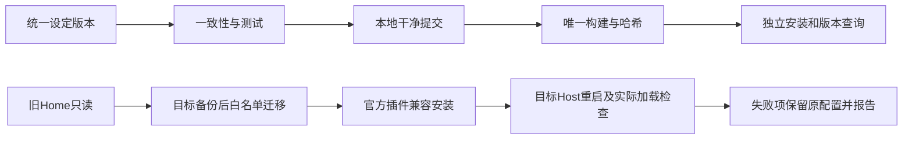

# 0.2.0开发版本、构建追踪与开发Profile迁移

2026-10-18；L2，用户已明确确认实施。新开发工作树codex/platform-dev；不推送、不正式发布、不改本机全局.agents。当前Home仍为validation/manual-preview/source-home；迁移前保留其配置和凭据备份，旧Home只读。

## 归属与接口

| 落点 | 职责 |
|---|---|
| packages/optdsh-bundle/lib/version.mjs | 产品版本/渠道/源码身份读取，安装版读不可变build-info，源码版读取当前Git；统一SemVer校验 |
| scripts/maintenance/version.mjs | version show/set/check；版本前进检查、同步根package/lock、README、CHANGELOG；不自动改所有独立插件版本 |
| scripts/maintenance/export-release.mjs | 拒绝脏树/重复测试版本/元数据不一致，唯一构建ID、SHA和组件清单；只导出本地测试包 |
| packaging/windows/install.ps1 | 校验并保留build-info及发布清单，安装回执记录产品/组件/构建信息 |
| packages/optdsh-bundle/lib/index.js与launcher.mjs | /api/optdsh-version与optdsh version运行查询；返回本次启动身份，不泄漏配置/凭据 |
| tests/installation、docs/versioning.md、CHANGELOG/README/STATUS | 夹具验证版本同步、脏树拒绝、重复版本、构建身份与运行查询；记录当前0.2.0-dev.1 |
| packaging/windows既有插件安装器及本轮temp迁移脚本 | 旧GLM配置/选定凭据ref按白名单合并；用官方插件管理器重装启用项，禁用项不激活，不沿用旧兼容豁免 |

## 版本规则

产品从0.2.0-dev.1开始；每次交付测试包采用唯一预发布版本。日常源码修改由Git提交及dirty状态区分；正式版本不可覆盖。组件独立SemVer；本轮新增Bundle公共查询能力，将Bundle也推进0.2.0-dev.1，其余包无本轮代码更改不机械同号。依赖DSH版本与产品版本独立。

## 步骤和验收

- [ ] V1 版本命令与当前产品/Bundle版本0.2.0-dev.1，同步锁/README/CHANGELOG。
- [ ] V2 构建门禁和安装身份；API/CLI查询与专门测试。
- [ ] M1 私有备份，迁移zai/glm-5.3-flash及其唯一凭据ref；旧默认非GLM不复制，按用户指定设置新默认。
- [ ] M2 恢复官方市场及原启用插件；新DSH拒绝旧版时核对兼容版，不豁免；禁用项保持禁用。
- [ ] V3 全回归、本地提交/标签、唯一测试包与仓库外版本查询。
- [ ] M3 当前开发Home加载与模型目录/插件状态实际回读，不发送真实模型请求；同步说明和共享日志。

当前用户正在使用3380。迁移前检查有无运行任务；没有任务时只停止当前身份匹配的开发Host，修改配置后恢复。真实模型调用、Zemax、旧现场切换和沙箱仍不纳入本轮。

M2实现补充：全局pnpm因Node升级遗留失效Corepack入口。按单一归属，将固定pnpm JS包声明为optdsh-bundle运行依赖，官方CLI在进程PATH优先使用本产品node_modules/.bin，运行中的plugin-manager配置也指向本产品命令；不修改全局pnpm/Corepack。安装器验证独立产品携带该声明依赖。

用户追加安装体验：Home路径可配置，不禁止用户主目录；首次图形安装应选择程序与资料目录，后续升级复用既有Home。当前仅CLI -Home与JSON配置，图形安装向导尚未实现，不冒充已交付；本轮不在手工验证期间更换当前Home位置。

## 中断恢复后的检查

产品/Bundle均为0.2.0-dev.1，版本专项、构建身份哈希、脏树/重复版本门禁已实现。完整回归通过147插件、53安装、11PPT、121光学、37分发、56架构kit；后续新增DSH精确依赖检查已做专项测试。GLM默认、凭据引用和8个启用插件active、8客户端HTTP200、市场查询accepted均已回读。最终本地包和Codex项目迁移在收尾后追加，不把计划勾选当作验收证据。
