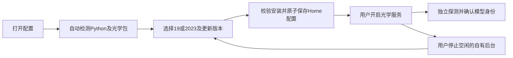

# Web光学配置与双版本只读验证（L2）

用户要求在Web完成配置，最终决定为Python完全自动检测、按2021及以前/2022起二选一，默认新版；沿用已选择的视觉专家。19已打开并启用API，授权只读连接验证；2025需准备时通知用户。禁止保存/修改模型及追迹。

归属：工作台lib负责环境发现、配置API、进程管理；web负责表单和状态。光学包负责19只读桥、真实版本核验及空闲停止。只使用本项目包，不修改全局环境或邻接项目。

- [x] C1 lib/service-settings.js：固定候选/系统发现Python，检查本项目光学依赖；Zemax安装发现，Web只提交版本标识，禁止任意命令。测试自动环境选择/缺失/安全保存/运行中保护。
- [x] C2 service-manager/index/config与运行引导：配置查询保存、停止接口；Home持久配置，Profile覆盖优先；仅停止本平台已验证身份的空闲后台，未知进程不接管。
- [x] C3 optics server：认证安全停止及忙碌保护；首次未绑定模型可探测，不能刷新未绑定模型；测试synthetic。
- [x] C4 optics runtime/capture/legacy19：PS5.1独立只读桥，核验19实际版本和模型，保留2023+流程。保存/追迹旧版不支持即明确拒绝。真实19只读验证，不提交商业数据。
- [x] C5 web配置弹窗与二选一、自动检测结果、保存/停止/启动；视觉专家实施、DOM测试及真实浏览器检查。
- [x] C6 同步版本、说明/证据、Profile升级、本地提交和测试包；不推送、不公开发布。2025已由用户打开并实测，不把19视为18完成。

范围补充（用户后续要求）：两插件会话头部入口统一复用官方Button ghost/sm与图标，在实际皮肤内验证；视觉专家中心源补充“先检查相邻宿主组件、优先复用、实际主题验收”的执行要求。分发预检遇现有资源无托管回执及DSH版本标识差异，保留生成副本，不强制覆盖；源修改与本轮实际使用另行验证。

连接组件独立审查及最终证据见docs/refactor/2026-10-18/connection-component-review.md。用户后续确认旧版类可复用18/19，正式模块已泛化为legacy.py/.ps1；其他具体年份未实测。当前实测19和2025，通过完整API构建与模型身份校验，不保存/追迹。

最终交付：代码及构建源027de78，本地不可变测试包E:/Proj-2026-N06_optDSH-releases/0.2.0-dev.13；工作台0.12.2/画板桥0.6.1/optics0.4.0。wheel在独立验证目录安装导入并确认正式legacy资源与BOM，非开发临时脚本依赖。最终111项插件专项、139项光学测试通过，最终实际皮肤深浅截图已看图验收。中心源规则已增强，生成宿主副本分发预检冲突未覆盖；共享事实和日志已记录。
