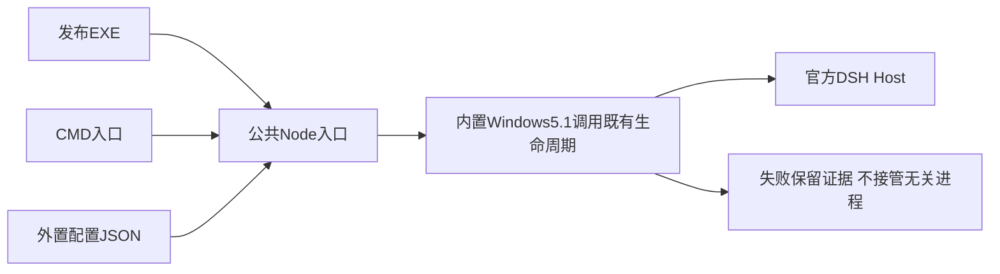

# Windows薄启动器实施计划

2026-10-18；L2。用户已确认：开发保留CMD，正式发布薄EXE，配置外置，普通用户无需另装PowerShell7。只在新开发工作树实施，不改全局.agents/Node/PATH，不启用沙箱或切换旧现场。

## 归属与接口

| 落点 | 职责及接口 |
|---|---|
| packages/optdsh-bundle/lib/launcher.mjs | 共用Node入口：start/status/stop，--config/--workspace/--no-browser；配置相对路径以JSON目录解析，调用唯一现有生命周期实现 |
| packages/optdsh-bundle/windows/Launcher.cs | 薄EXE：定位Node及共用入口，转发参数/退出码；不含业务配置和服务管理逻辑 |
| scripts/maintenance/build-windows-launcher.ps1 | 用现有Windows Framework编译器构建到指定产物目录；不安装SDK或改全局 |
| scripts/runtime/launch-config.ps1、open-dsh.ps1、start/status/stop-dsh.ps1 | 将公共启动链适配内置Windows PowerShell5.1；保留认证、PID/启动时间/命令行/端口核验、profile互斥 |
| packaging/windows/install.ps1、scripts/maintenance/export-release.mjs | 安装/导出EXE及外置optdsh-launcher.json；CMD与EXE复用Node入口；二进制不进入Git |
| tests/installation | 配置错误、Unicode/空格路径、参数边界、无pwsh PATH下EXE启动/复用/状态/停止及无关进程拒绝 |

Node24、Python及Zemax仍由用户安装，EXE不打包运行时。复用系统自带5.1作为Windows生命周期辅助，不额外维护一套进程/认证实现；并非把所有复杂逻辑塞进EXE。

## 实施与验收

- [x] L1 决定Q9及启动方案落盘。
- [x] L2 内置5.1兼容与回归：路径、JSON、Unicode、现有归属拒绝逻辑。
- [x] L3 Node入口、薄EXE及构建；普通用户不需要构建工具。
- [x] L4 本地产物/安装器接入，外置配置无凭据，不覆盖用户home。
- [x] L5 无pwsh搜索路径下验证仓库外EXE与真实DSH启动/复用/停止；完整相关离线检查。
- [x] L6 同步状态/工作簿/本地提交；未做沙箱、公司实机、真实模型或Zemax，不能宣称最终发行验收。

实现阶段回执：内置5.1专项14项、EXE参数/编码/退出码3项、安装器SHA/越界5项通过；完整原有回归通过。L5的仓库外真实EXE仍待下一步，未以编译通过代替安装验证。

## 用户追加：Node版本下限

2026-10-18用户确认Node>=24，不设仅24的上限。统一root/包锁/Bundle engines、setup/启动器/安装器/验证器/EXE提示及文档；分别实测已有24与26。未来版本可尝试但不预先宣称全部通过。已发布候选产物保留历史证据，最终用新产物复测。

最终阶段验收见docs/refactor/2026-10-18/thin-launcher.md；008仓库外EXE在24/26均通过，未进行公开发布或真实业务。
