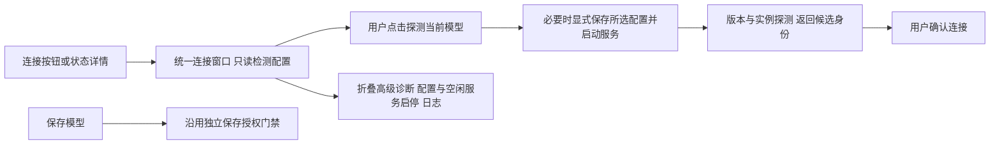

# 工作台紧凑顶栏与统一连接窗口（L2）

用户已完成三轮AgentCanvas评审，明确授权直接修改前端。最终稿为temp/workbench-entry-wireframe-20261018/revision-3.excalidraw：三个无标题外框、原“操作设置”保留、日常模型操作集中，服务细节收入连接窗口。沿用用户已选择的视觉专家，不再次确认。

归属：全部交互实现和测试在plugins/optdsh-workbench；不新增后端接口或库，不修改光学连接/保存执行器。版本、部署、说明和脱敏证据由主线程负责。

- [x] U1 web/workbench.html、workbench-shell.css：顶栏三组无可见组名，中文注释保留语义；只读状态+详情；合并版本/环境/模型连接，保留独立操作设置。视觉专家检查实际页面空间与明暗。
- [x] U2 web/service-controls.js、workbench.js：复用现有API。仅显式探测操作可准备配置/启动服务；打开、检测、轮询不启动/探测。失败不继续probe；运行中不自动停服务换版本；版本/实例改变使候选失效；保存保持显式。
- [x] U3 所属tests：模拟首次准备、已就绪复用、依赖失败、版本变更、忙/失败反馈及无隐式保存；DOM与权限/连接回归，不触发真实Zemax操作。
- [ ] U4 统一升版、文档、Profile本地包升级、浏览器实际深浅检查与只读就绪回读；本地提交和测试包，不推送、不公开发布，保留当前后台与真实模型。

根目录无新入口，仍从既有启动DSH/工作台CMD进入。顶栏不渲染分组标题、不为标题增加高度；不扩大改动到聊天、视口布局或确定性分析。

实际画面检查：1920×1080深色、1440×900浅色、1280×720深色；顶栏40px、状态条35.33px，三组保持同一行，页面无横溢。1280连接窗默认481.59px，高级日志展开可滚至确认。77项工作台回归、实际模块模拟流程及文档检查通过；真实服务当前stopped，未为审图启动/探测/保存模型，用户文件哈希不变。详见docs/refactor/2026-10-18/evidence/workbench-compact-ui-dev14.json。
