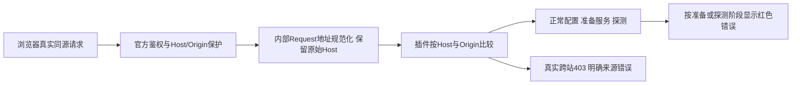

# 工作台浏览器来源检查与错误呈现修复（L2）

用户实际点击探测暴露正常同源请求被拒，并明确要求错误标红。为已有HTTP/前端契约修复，不新增API，不修改DSH安装源码，不放宽真实跨站检查。

根因已现场核对：@deepseek-ai/dsh-client-connection/lib/index.js 的bridge以http://dsh.internal构造Request，同时保留原始Host/Origin。自有插件错误使用request.url.origin比较浏览器Origin；此前PS验证未携带Origin，模拟Request也未复现真实carrier包装。

- [x] O1 lib/index.js与profile-runtime.test：兼容内部URL的同源判断；真实cross-site/Origin Host错配继续拒绝；无Origin的已鉴权CLI保持可用。
- [x] O2 web/service-controls.js、workbench.js、workbench-shell.css与所属测试：错误红色、状态恢复清色；准备失败不提示API实例；失败不继续probe。
- [ ] O3 真实浏览器携带Origin的无副作用校验请求，随后按用户已授权真实只读探测验证；不保存/追迹模型，保留候选供用户确认。
- [ ] O4 升版、Profile本地安装、必要回归、状态/证据/本地提交与测试包；不推送/公开发布。

真实浏览器额外发现：API探测已返回92对象，但旧绑定RESTORED_SNAPSHOT提示在轮询时错误清掉新候选。已修为仅真实绑定/版本/实例变化或实际连接错误失效，预期旧快照提示不清新候选；模拟回归覆盖RESTORED_SNAPSHOT/MODEL_CHANGED和绑定变化。版本推进工作台0.13.2，正式浏览器复验使用最终包。
