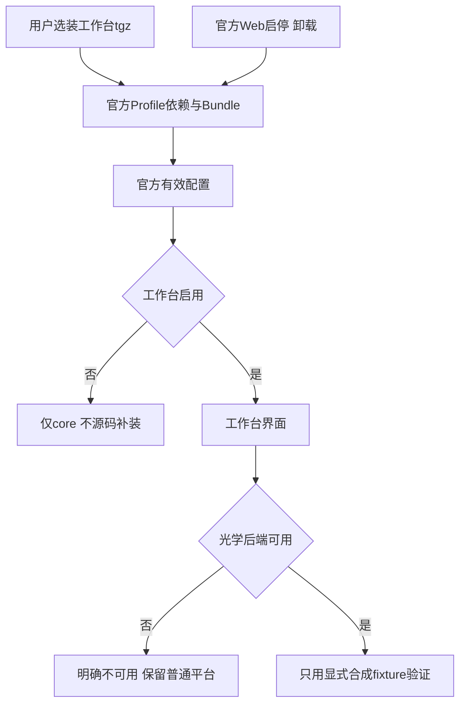

# 光学工作台官方Profile生命周期

2026-10-18 L2。用户授权先方案落点再新开发目录实施；不连接真实Zemax、不调用真实模型、不推送/npm公开。复用Canvas已实测机制，不另造开关数据库。

## 归属与落点

- packages/optdsh-bundle/lib/profile-components.mjs：泛化Canvas的官方配置解析为canvas/workbench白名单共用读取；Profile依赖/Bundle选择/Profile和Home patch为事实源，拒绝app shadow和源码fallback。
- compose.mjs/index.js/cli.mjs：两组件不insert、不强启用、不因components恢复；状态动态反映官方启停。Bundle推荐及默认仍在平台层，显式Profile配置优先。
- packaging/windows/install-profile-component.ps1、install.ps1：Component canvas/workbench白名单，调用官方CLI安装/停服升级/移除，本地tgz校验；工作台不进入app runtime dependencies，旧Canvas调用兼容。
- plugins/optdsh-workbench/lib/config.js、index.js及包内测试：独立解析Home/Profile/环境默认，不依赖源码根；后端配置/服务缺失与连接异常不影响core，不自动启动光学。不改几何/求解算法或真实模型。
- scripts/runtime/open-optics.ps1、根工作台CMD：默认只启动基础DSH并检查官方工作台启用状态，然后打开页面；不安装/重启用；光学服务须显式单独动作，默认不连接Zemax。缺包/停用时给诊断，core可用。
- 根package workspaces、config/dsh.local-policy.yml：工作台源码保留plugins，但取消隐式app workspace安装和旧源码挂载；依赖安装交给npm，不手改node_modules。
- tests/installation及temp任务验证：重用Profile生命周期夹具/官方RPC，对独立工作台无Canvas/Forms、无后端、合成后端可选接入、启停/升级保持off/卸载无回流、画板/会话/用户数据保留取证。
- docs/profile-plugins.md、workbench/architecture/runtime、STATUS、决定及交接：明确源码/安装、命令和已验/待验，版本和本地产物追踪。

## 任务

- [x] W1 方案落点与依赖勘察。
- [x] W2 共用Profile状态/安装器泛化，工作台源码副本退出app。
- [x] W3 工作台独立配置、缺服务边界、启动入口安全行为。
- [ ] W4 离线及真实隔离Profile生命周期/独立安装/运行身份验证。
- [ ] W5 日常预览接入、文档/本地提交和测试包/共享日志。

## 验收与限制

停用entry和Bundle、关闭后重启不回流、停服升级保留off、官方卸载后重启不复活；不得影响Canvas既有生命周期。只读普通会话创建可用于绑定验证，无模型prompt；光学只使用离线夹具/合成服务，禁止真实ZOS-API连接、追迹和写盘。无后端时core和插件管理仍ready，工作台明确报告缺失，不能把synthetic当真实Zemax通过。停用工作台不终止共享光学/编辑器，不删Workspace、历史报告、绑定或会话。其他插件如Forms后续逐项收敛。

勘察补充：agent-policy注册原本绑定在Agent scope，插件卸载不会自动移除。W3追加显式dispose登记并在插件shutdown清理，保证Agent继续存在时光学提示词也撤销；不改变模型权限或已有会话历史。

W4当前结果：完整151插件/98安装/11PPT/123光学/37分发/56架构kit通过；20项父侧Profile/入口专项及16项安装器矩阵通过。实际隔离Profile独立工作台无画板/Forms/后端、UI和Three/manifold资源200、光学缺失503、synthetic HTTP代理、entry/Bundle启停/停服升级保持off/官方卸载重启不复活/绑定与课题哈希保护均通过。故障注入语法坏包仍core ready，不兼容版本被官方拒绝并还原，无版本豁免；均为测试夹具不公开。

真实页面补充：修正旧UI把插件版本称项目版本、把会话描述成仅只读工具的文案，布局/权限不改。为保留已构建dev.9候选，最终产品推进dev.10、插件0.9.1；该正式包与前面的0.9.1升级测试夹具为不同哈希，不混用。
