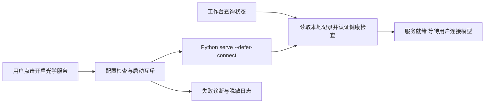

# Web光学服务启动（L2）

用户已同意Web显式启动、服务与Zemax连接分离，并选择视觉专家参与。工作台随产品提供，保留Profile生命周期。

归属：工作台插件管理本地执行器启动与状态；光学包提供不触模型的健康检查和延迟连接；配置来自Profile/Home，不接受浏览器传入可执行文件或Shell命令。失败不影响基础DSH，服务不会因刷新、插件重载或卸载自动启动/停止。

- [x] W1 工作台lib/service-manager.js、config.js、index.js：service-status/start/logs，固定命令、互斥、健康身份校验、失败诊断。所属tests验证重复启动、缺配置、失败、无隐式启动。
- [x] W2 packages/optics server.py：--defer-connect及认证/api/health；子进程synthetic测试，禁止真实Zemax。
- [x] W3 工作台web局部状态条、显式按钮、等待状态与文本日志；视觉专家实施、浏览器模拟验收。
- [ ] W4 统一升版、文档与本地Profile包升级、针对性回归；不推送、不公开发布，不连接真实Zemax。实际配置若未就绪，明确待验证。

运行记录在state/.runtime，日志在state/logs/optics；无服务停止入口，本轮不扩展自动重试/后台计算能力。
