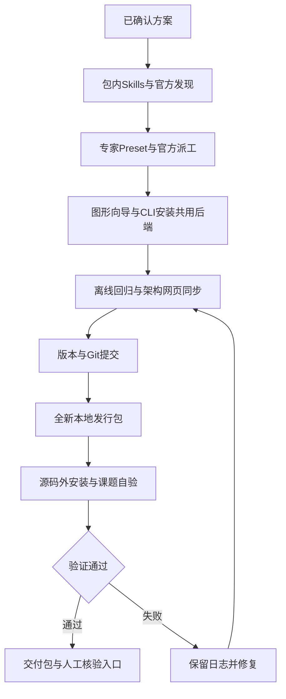

# 产品资源、官方专家装配与图形安装交付

用户已确认前轮方案，并授权制作本地发行版、图形安装向导、Git提交及独立验证。禁止修改全局.agents；不公开npm、不合主分支、不发布远程Release。图形方向另按本次视觉专家确认执行。

## 设计与边界

- 产品Skills归所属包，使用官方Skills Provider/注册服务；源码.agents保留开发入口，必要的兼容链接不得产生第二份实体源。
- 专家声明通过官方Agent Preset与Profile装配，官方spawn派工；保留公共参考资源适配，移除源码cwd绑定及自建派工。
- 公共专家基线从中心白名单导出固定快照，不携带私人偏好、图片或本机路径；不修改中心源。
- 图形向导为本地浏览器界面，复用Windows安装器、清单校验和安装回执；不新增系统服务或全局依赖。待本次界面方向确认。
- 发布版先提交固定源版本再构建；历史包不可变；最后自验使用源码外安装、Home、空共享根与合成课题，真实模型仅小范围验证技能/专家，绝不连接或追迹Zemax。

## 任务与验收

| 任务 | 文件落点/接口 | 验证 | 完成 |
|---|---|---|---|
| 产品Skills | 所属plugins/packages的skills、官方注册/文件Provider、开发兼容入口 | 空共享根/外部项目catalog及正文/资源路径、停用不暴露 | 已实现/原型及真实会话验证通过 |
| 官方专家 | optdsh-experts的Preset、公共基线、资源工具、Profile安装器 | 注册、固定专家工具、官方spawn、资源隔离、停用卸载保持 | 已实现；真实派工和停用保持通过 |
| 安装向导 | packaging/windows与可分发web资源；本地plan/install/status API | 路径校验、Origin/令牌、单任务、失败回执、真实浏览器安装 | 已实现；原型真实安装/视觉审查通过 |
| 文档与回归 | architecture正文/网页/图、STATUS/ROADMAP/安装指南 | 项目检查、适用测试、浏览器截图审查 | 已更新四视图；自动门禁与截图复核通过 |
| 本地发行 | 版本/CHANGELOG、export-release、安装清单/图形入口 | clean Git构建、SHA、安装回读、源码外课题与小范围真实Agent | 已完成dev.25用户包与源码外实际安装/启动/随包卸载验证；待用户人工核验 |

保留他人已有改动及上一阶段文档改动。不得通过改node_modules解决适配，不覆盖真实Home、旧安装或课题。

## 用户追加范围（2026-10-19）

- 路径选择式卸载：程序/自有插件/日志可选；课题永远不在范围，Home与共享资源保留。随包回收器、官方插件管理、数据哈希及真实UI验证。已实现并完成实际回收/6项数据哈希验证。
- 安装端口探测与自动避让：Web/Canvas/光学/PPT，兼容Canvas可复用；PORTS.md/ports.json/安装回执记录实际值。已实现，真实WinPS5冲突预检与占用监听器单测通过，最终dev.25包实装、配置回读、Web/Canvas运行及随包卸载日志检查通过。

最终用户包仅安装EXE/说明/_support；固定构建源db862c008049cfeee1f8d1a43b18493dd3e87c6d，后续文档验收提交不改写该包。最终回执见docs/verification/dev25-user-release.md。
