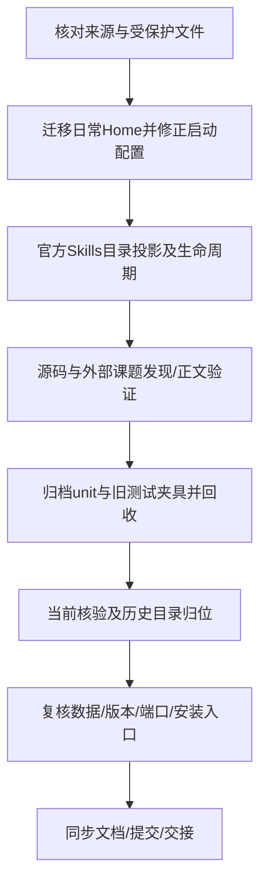

# 日常源码Home、官方Skills入口与验证区整理

2026-10-19，L2；用户已明确授权立即实施。允许新建的唯一磁盘顶层目录是E:/.optdsh-source。其余复用既有源码、releases及validation根。保留用户数据、原始课题及验收记录，不自动合并分支或推送。

## 设计

- 将日常开发Home从validation/manual-preview/source-home迁到E:/.optdsh-source，活动StateRoot迁入其state/web。停自己的Host后迁移，哈希验证会话/资料，修改当前配置及重启身份，不改写历史记录。
- 产品Skill实体继续归模块；受管入口投影到DSH_HOME/skills，源码运行还投影到源码.dsh/skills。采用链接保留资源相对路径，以来源清单和目标身份保护用户自定义；可选插件随官方Profile状态更新入口，发现仍由官方服务完成。
- 安装器安装结束同步入口；运行启动及Profile状态变化继续同步。新实现独立版本不覆盖固定dev.25原件；现有dev.25现场用明确的维护适配补齐入口，记录与固定包的差异。
- 验证区当前核验与历史分开。自动unit夹具全量归档校验后回收，未来写临时测试批次并在退出时保留记录/回收程序；源码STUDYS兼容夹具同样归档退出，不动真实课题。
- 当前核验入口清晰命名，原始发布版本保持字节不变；当前安装移动后更新配置/归属并复验。

## 任务

| 任务 | 文件落点与接口 | 验证 | 状态 |
|---|---|---|---|
| 日常Home迁移 | .runtime/preview.json；E:/.optdsh-source及当前状态配置 | 停服归属、保留哈希、迁后3380认证与版本 | 已完成，见本轮验证回执 |
| Skills投影 | bundle/lib/managed-skills.mjs；compose/index/CLI；install.ps1 | 标准目录、用户冲突、链接身份、可选状态、官方Provider与RPC | 已完成，见本轮验证回执 |
| unit退出 | tests/installation/verification.test.mjs及测试批次 | 记录归档、无根unit、无遗留进程 | 已完成，见本轮验证回执 |
| 目录归位 | 既有发布区/验证区、入口说明及映射 | 当前dev.25启动、历史字节/数据保留 | 已完成，见本轮验证回执 |
| 同步收尾 | development/architecture/STATUS及回执 | 相关测试、项目检查、Git提交、共享日志 | 文档与完整回归通过；固定dev.26构建/最终交接收尾 |

## 用户追加：经验库与远程发布

用户要求检查.experience是否随安装分发，并确认该经验资产要分享。检查发现原导出/安装均未包含，补齐Markdown白名单、SHA清单及Home/.experience安装，保留用户修改，历史run只留说明。用dev.27发布，不覆盖dev.26。用户已明确授权验证通过后合并、提交、推送及有权限时上传GitHub Release；按远端状态安全合并，不强推，标签定位真实构建提交。
