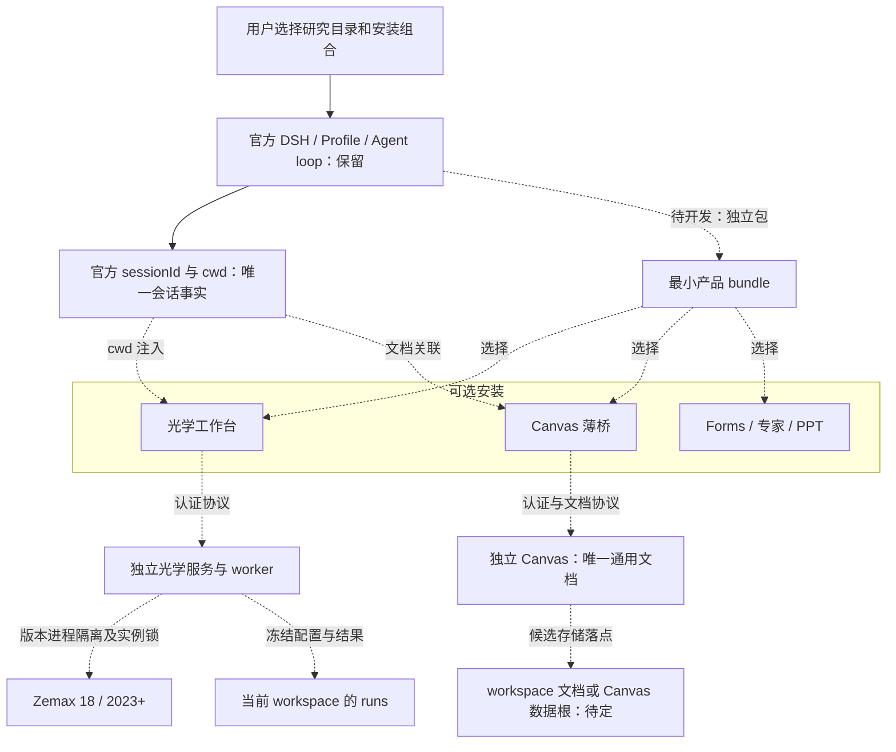
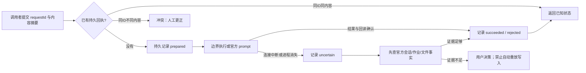
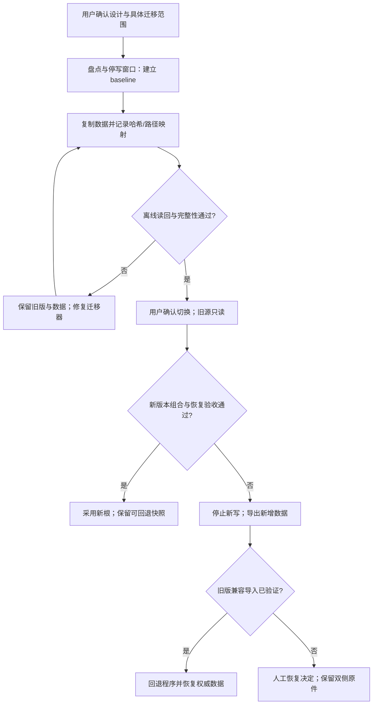

# 平台与插件重构：目标架构草案

日期：2026-10-18。**状态：用户已授权在独立分支实施；Q1–Q7见decisions.md。沙箱验证暂缓，现役数据和服务暂不切换。**

[统一阅读页](index.html) · [决定与待定项](decisions.md) · [详细实施计划](../../../.agents/plans/261018-platform-plugin-refactor.md) · [现役架构](../../architecture.md)

本设计面向长期、多 Agent 协作项目。涉及安装入口、公共接口、插件、数据迁移和双版本光学执行器，因此定为 L2。以下“应”“拟”“推荐”均为目标要求，不表示已实现。现役行为仍以当前源码及 planning/STATUS.md 为准。

已确认的具体选择：optDSH使用独立资料目录，所有光学课题共用，不与普通DSH混用，也不按课题复制home。决定正文见decisions.md的D8/P1/Q1；具体Windows路径和迁入流程尚未确定。本轮已授权代码实施，真实数据迁移切换保留停写窗口。

## 1. 依据、范围与复用

用户已明确方向：平台安装与研究课题分离；研究可在任意目录；Canvas 独立安装并通过薄桥接入；工作台同仓开发、是可选及可独立打包插件；遵循官方 DSH 的包、bundle、profile 机制；发布包含架构、使用与新机验证说明。具体技术选择见 decisions.md，未决项不因绘图或本草案而自动接受。

2026-10-13 调研与 2026-10-18 读图对照已识别以下源码事实，本轮读取相关入口复核：

- `scripts/runtime/start-dsh.ps1:68-91` 同时掌握项目 Python、专家分发、DSH_HOME 与 cwd。
- `plugins/optdsh-workbench/lib/index.js:14-20,47-50`、`plugins/optdsh-agent-canvas/lib/index.js:13-27` 将会话 cwd 约束到平台仓库根。
- `plugins/optdsh-workbench/web/workbench-agent.js:7` 静态导入 Canvas transport；工作台独装存在依赖缺口。
- `plugins/optdsh-agent-canvas/lib/boards.js`、`drawing.js` 拥有通用文档、版本、建议与编辑；外部 N05 当前提供编辑器，不等同全部通用画板服务已独立。
- `packages/optics/scripts/server.py:11-23` 和 `src/optdsh_optics/service.py:55-59` 依赖仓库布局；`scripts/mcp.py:66,76-77` 了解固定 Study。
- 自有插件已有 `plugins/` 归属、客户端元数据及部分 files/exports，但主要包 `private:true`、缺独立交付契约；市场插件位于 Git 忽略的 profile，根锁文件不能复现其组合。

保留官方 Agent loop、Standard 权限和会话事实源，保留现有 HTTP 光学边界、模型/revision 门禁、保存回执、Canvas revision/冲突恢复、请求去重与 uncertain 状态。优先配置注入和官方 `sessionId/cwd`；不新建 workspace 注册服务、插件管理框架、第二套聊天数据库或通用依赖注入容器。

## 2. 五种根与状态归属

具体 Windows 路径尚待确认；配置使用角色名，不把开发机路径写入代码。安装根可为用户级位置，全局可调用不要求系统级管理员安装。

| 名称 | 唯一职责 | 允许内容 | 明确边界 |
|---|---|---|---|
| installRoot | 版本化、可替换的程序安装 | 官方 DSH、薄启动器、公共资源和离线文档 | 不放研究、会话、凭据、恢复快照；升级可替换程序 |
| dshHome | optDSH专用的官方宿主用户数据 | 官方 profiles、sessions；自有状态用独立命名空间 | 已确认与普通DSH隔离，所有光学课题共用；保留官方格式，不另存可写聊天历史；物理路径待定 |
| workspaceRoot | 官方会话 cwd 所指用户目录 | 课题定义、配置、模型、附件、runs、报告和课题 Skill | 不强制 STUDYS 名称、不要求复制平台、不按 cwd 加载任意可执行插件 |
| canvasDataRoot | 独立 Canvas 的通用文档事实源 | 文档、revision、提交快照、建议稿、冲突和恢复历史 | 推荐 workspace 就近存储；最终路径待定；DSH 只留文档绑定及投递回执 |
| opticsStateRoot | 执行器跨课题的持久状态与恢复索引 | 实例身份、作业索引、互斥租约、保存回执/恢复索引 | 不能按课题各建互不相知的实例锁；正式 run 仍归 workspace |

日志及运行时文件属于所拥有组件的状态根内的 `logs/`、`.runtime/`；PID、临时 token 和锁与持久恢复证据分开。`opticsStateRoot` 可默认位于用户状态根，自有数据是否置于 DSH_HOME 内需先核对宿主扩展约定。独立光学 CLI 必须能显式接受相同 state root，避免只能依赖 DSH 才能互斥。

研究目录可只有 README 和文件，普通会话不要求 study.yaml。光学流程需要结构化配置时，由用户选择或明确的 workspace 声明定位；不得自动回退到某个固定 2t2rLidar。

拟议目录角色如下，均未创建：

```text
<installRoot>/                    固定版本程序与离线说明
<dshHome>/profiles/<profile>/     官方组装、覆盖、依赖锁与插件安装
<dshHome>/sessions/               官方唯一会话记录
<用户状态根>/<插件命名空间>/       会话绑定、投递回执与配置
<opticsStateRoot>/{instances,jobs,recovery,.runtime,logs}/
<独立Canvas安装根>/               编辑器、文档服务、CLI和协议声明
<workspaceRoot>/
  README.md / AGENTS.md           用户课题规则
  study.yaml                     可选课题入口，不是平台启动前置
  configs/ models/ runs/ reports/
  .agent-canvas/                 推荐的文档落点，尚未确认
```

## 3. 组件、包与依赖方向

| 组件/源码落点 | 拟交付形态 | 必需依赖/边界 |
|---|---|---|
| 官方 DSH | 固定受支持版本的官方包 | 不 fork loop，不改 node_modules；升级单列验证 |
| `scripts/runtime/`、拟 `packaging/windows/` | 薄启动/安装与发布描述 | 解析路径、profile、选择项，调用官方入口；不承载研究计算 |
| 拟 `packages/optdsh-bundle/` | 可独立分发 npm bundle | 用官方 `dsh.bundle.patch` 指向包内 patch；最小基座不传递安装所有可选包 |
| `plugins/optdsh-workbench/` | 独立 npm 插件及包内 patch | 官方会话与光学协议；Canvas/Forms 为可选能力 |
| `plugins/optdsh-agent-canvas/` | DSH 认证、会话、工具与 UI 薄桥 | 通过独立 Canvas 协议绑定 documentId/revision；不拥有通用可写文档 |
| 独立 AgentCanvas（外部项目） | 单独安装与升级 | 唯一通用文档模型、编辑、版本、建议稿和恢复；修改邻接项目需另行明确范围 |
| `plugins/optdsh-forms/` | 独立可选插件 | 从所选 workspace 读声明并持久化请求；不依赖工作台 |
| `plugins/optdsh-experts/` 和公共资源 | 可选插件与公共分发包 | 不要求开发者个人中心 Junction、私人截图或 preferences |
| `packages/optics/` | wheel＋命令入口＋版本适配执行器 | 不导入 Study、DSH UI 或 Canvas；供 DSH、CLI 两个真实调用者使用 |
| `packages/ppt-slidewise/` | 继续可选独立模块 | 不成为纯平台、光学或画板的启动前置 |

新建 bundle 包因为存在确认的产品组装需求；新建 `packaging/windows/` 存放发布生命周期而非运行逻辑，`tests/installation/` 存放跨包产物验收。这些是候选新增目录，须在设计确认时接受，不预建空目录。

源码仓库拆分与独立安装是两项决定。推荐第一轮保留现有 monorepo、分别构建/发布插件，独立 Canvas 保持原项目；包在没有源码 checkout 的干净环境中可安装才算边界成立。若后续按维护者或发布节奏拆仓，不能改变数据/协议契约。

下图是目标，全部虚线能力为待开发；现役 loop 和会话能力以实线保留。具体 DSH 工具不作为业务核心的固定身份。



Canvas 和 Forms 不在工作台的静态导入主链。工作台启动只验证自己的必需能力；可选能力在加载后探测。缺失时对应入口不可用，核心会话、快照及合法的光学操作保持可用。连接失败必须呈现真实失败，不能以 synthetic 数据冒充当前 Zemax。

## 4. 最小公共契约（拟议签名，不是现役 API）

先复用现有函数/对象，不为每个契约新建包。跨宿主只共享确有两个调用方的光学和 Canvas 协议。配置优先级、字段名和 CLI 拼写在 T1 冻结后才成为兼容承诺。

```text
resolveLaunch({ installRoot, dshHome, profile, workspaceRoot, stateRoot }) -> LaunchContext
  显式参数优先于本机配置与默认值；验证根的职责，不用进程 cwd 代替全部根。
inspectSession(sessionId) -> { sessionId, cwd }
  直接复用官方 sessionController；绑定前校验会话 cwd 与用户所选 workspace。
readCapabilities() -> { protocolVersion, optionalFeatures, supportedVersions }
  返回可用能力与不支持原因，不以依赖已安装冒充实际服务已就绪。
bindCanvas({ sessionId, workspaceRoot, documentId? }) -> { documentId, revision }
  独立 Canvas 决定文档身份；桥接只保存宿主绑定与授权范围。
submitCanvas({ requestId, sessionId, documentId, revision, snapshotRef }) -> DeliveryReceipt
  一次显式提交冻结快照；重试读回同一回执，不重复 prompt。
startOpticsJob({ requestId, sessionId?, workspaceRoot, target, configRef }) -> JobReceipt
  target 明确版本与实例；配置冻结并通过身份和互斥检查后启动。
cancelOpticsJob({ jobId, requestId }) -> CancellationReceipt
  请求取消与已取消/副本清理完成分别记录。
```

鉴权仍走官方承载或独立服务自己的本地认证。配置不接收客户端任意 URL/脚本路径去执行；路径规范化与服务端授权范围验证防止跨课题读取和越界写入。Canvas 来源和端口由配置注入并校验；实际 frame origin 必须与握手匹配。

绑定分清 `sessionId → cwd`、`sessionId → documentId`、`sessionId → optical binding`。不因为保存了关联就复制文档或改写会话历史；光学实例换模型后旧 `bindingId/modelId/revision` 拒绝，不按 OBJ 号静默重绑。

### 请求、事件与结果不确定

各边界继续使用持久 requestId＋规范化请求内容摘要。同 ID 同内容读回既有结果；同 ID 不同内容返回冲突。Canvas 投递回执和光学作业状态是各自领域，不将 Agent 回答完成当成仿真完成、用户接受或 Canvas 已应用。



事件携带 `eventId/requestId/entityId/revision` 及来源，订阅重连按游标/ID去重；确实无法回放时重新读取权威快照而不是猜测状态。只在真实需要的服务边界实现，不引入平台总线。跨 Canvas 文档提交和 DSH prompt 不承诺分布式原子事务：使用快照和持久回执表达接受、已投递、结果不明。

## 5. Canvas 独立化与既有数据

推荐把 `BoardStore` 中通用的文档、编辑、revision、建议稿、历史快照及冲突恢复移向独立 Canvas 产品；DSH 桥保留鉴权、会话绑定、工具参数/消息适配、投递去重。公共协议优先扩展外部 Canvas 已有嵌入通信，不另外创建独立 inbox 作为 DSH 聊天事实源。

文档存储已确认位于 workspace 的 `.agent-canvas/`，利于携课题迁移；集中 Canvas 用户数据根便于跨项目管理但需要导出/备份。两者不可双写，本轮保留为待定。迁移时保留旧 boardId 的可追溯映射，不假设新 Canvas documentId 等于旧 boardId。

迁移导出至少覆盖 scene（含图片附件引用）、revision、submissions/snapshots、edits/proposals、拒绝反馈、冲突恢复文件、会话关联和既有投递 requestId。不能只迁最终画布而丢掉已提交证据。旧 uncertain 保留其语义，不重新当成未发送自动投递。

推荐先实现旧格式导出/新格式离线导入和核验，再切写入。旧目录保留只读，写入权只在一个版本；如新版本已产生数据，回退前先导出并验证旧版本能接受，不能直接切回造成静默丢失。外部项目变更必须另行明确授权，当前计划只记录跨项目接口与验收依赖。

## 6. 光学执行器、版本与同实例互斥

将 server/MCP/worker 的入口纳入 Python 安装包，适配器从安装资源找源码/模板，不再向上寻找根 AGENTS/package.json。worker 显式接受冻结配置、workspace/run、state root 和 target；当前 run/reporting、保存回执和模型/revision 门禁复用。

`target = { expectedVersion, installDir, extensionInstance, expectedSystemFile, systemId? }` 为候选逻辑字段。18 与 2023+ 的 DLL 分别装载在独立子进程，回读实际版本、SystemFile、实例身份；不以 PATH 或“安装过”认定选中了正确版本。未来需要时按已验证运行时选择 adapter，不为了统一接口强迫旧版本使用已失败的 Python 路线。

共享记忆 2026-10-05 只证明 19 版通过 Windows PowerShell 5.1/.NET Framework 显式加载 DLL并只读回读；当时项目 Python 在 Python.Runtime 阶段失败、PowerShell 7 缺所需 .NET Remoting。该历史证据不能视为 19 版完整业务适配；19 版追迹、保存、补偿与 2025 数值一致性分别待验。2025/现役历史光学样本也不替代新 wheel 与新机验证。

锁范围按实际 Zemax 实例，不按 workspace；两个课题指向同实例时互斥，刷新/绑定/保存/分析等可能触碰宿主的操作使用同一个边界。初期同一 Windows 用户下统一 `opticsStateRoot` 即可；跨 Windows 用户同时控制同实例是否支持待定，不伪称用户目录文件锁能覆盖全机。

锁身份使用版本、宿主进程身份/启动时间和 Extension/SystemID 的已验证组合；实例序号、端口或文件名不足以单独作为全局身份。新 token/租约不得在旧作业状态不明时抢占。worker 崩溃先查宿主和副本清理、恢复索引；无充分证据返回 busy/uncertain 供人工处理。正式结果始终携带实际版本、配置、输入指纹、运行证据，数值验收与 API 接通分开。

## 7. 分发、市场插件和公共资源

每个发布包应有：manifest、包内 patch、依赖及宿主兼容范围、默认配置/schema、资源白名单、LICENSE/第三方声明、独立安装/停用/升级/卸载说明，以及产物哈希。官方包内 bundle 与 profile 顺序继续由官方管理，不建立另一个插件目录约定来绕过其机制。

产品 release 清单（拟 `packaging/windows/release-manifest.example.yaml`）记录组件版本、完整性摘要、必选/可选关系、前置 runtime 和平台范围；插件选择清单记录包名/精确版本、启停状态、bundle 顺序与经用户确认的兼容豁免。实际 profile 依赖锁单独保存或构建，不拿根 package-lock 冒充其锁。语义清单不能含 API key、个人模型地址、认证状态或完整私人 profile。

先读取已有用户 profile，展示安装差异，再合并用户选择；禁止无条件覆盖用户覆盖层或把 disabled 插件重新启用。peer 范围拒绝不自动换宿主、不自动批准版本豁免。锁文件、依赖已安装、bundle 已登记、实际已加载、交互可用分别记录。

专家/Skill公共资源按发布白名单打包，可从当前中心分发器复用构建逻辑，但终端安装和启动不能依赖开发者 `~/.agents`。私人 preferences、截图、私人库、凭据、宿主本机 fleet、Junction 目标均不发布；符号链接需要构建期解析和内容审计，不能把“链接存在”当成资源已随包。课题专属技能留 workspace；公共光学 skill 不包含真实商业输入。

## 8. 迁移、回退与验收边界

采用复制到新根→哈希核验→离线读回→用户安排停写→切换的方式。迁移清单记录源/目标路径、源版本、字节摘要、映射、排除项、迁移状态与新写入起点；原始 run 整包不改写，不对旧配置做原位路径替换。需要新路径时通过新配置和映射解释，历史文件仍保留原貌。

官方会话按官方格式迁移与读回，迁后 sessionId 不人为重建。插件绑定按映射重接；失联研究目录或模型路径只显示待重绑定，不静默猜新文件。进程/PID/端口/锁/token 重新生成，长期恢复记录和备份按保留策略迁移。



安装验收先用正式 tarball/wheel/发布包，不能从 monorepo 源码启动替代。覆盖：纯平台、仅工作台、仅 Canvas、两者共存、Forms/专家/PPT选装、两个外部 workspace、中文/空格路径、缺组件、升级/回退、端口冲突和受限网络。

三层测试各有边界：Windows Sandbox 检查干净安装与临时状态；持久 VM 检查重启、升级、卸载、历史数据恢复和指定运行时；公司实机检查公司网络/模型出口策略、权限、许可证、目标 Zemax 版本和实际业务。Sandbox 通过不能替代 VM/公司实机，也不能用宿主 127.0.0.1 服务冒充沙箱内安装。当前只规划，不启用系统功能、安装运行时、启动真实模型或 Zemax；各层真实执行另取具体授权。

正式发布附离线架构/使用说明、Archify 源 JSON/HTML/回执、组件清单与兼容表、在线/离线安装、任意 workspace 示例、插件选装/停用、配置与密钥注入、迁移/回退、排障和证据等级。Archify 是开发交付工具，不成为产品运行依赖；计划中的任务、流程仍以 Mermaid 为可编辑权威。

## 9. 当前交付与下一步

部署验证已细化为[Windows沙箱专项](windows-validation.md)：最小发布链形成即先做基线、随插件/依赖变化回归，按Sandbox→持久VM→公司实机分层；不把测试推迟到重构最后，也不把开发机的隐含环境当成发布内容。本轮只补充方案。

本轮已交付目标设计草案与计划文本，未执行其中代码任务、数据迁移或功能验收。下一步由主会话合并 decisions.md 的三组关键选择；设计确认后只启动计划中相应任务。视觉稿和部署证据必须沿用本文件的边界与“待开发”标识，图形检查通过不提升产品状态。

## 2026-10-18实施确认

Q2不捆绑Node/Python/Zemax；依赖安装时下载。Q3保留optDSH与工作台同仓，独立打包且故障隔离；Canvas保持独立仓库。Q4文档跟随workspace。Q5目标为18和2023+两条适配线；上述19版历史证据只作参考，不构成18实测。沙箱、VM与公司验收暂缓。本文历史“候选/待定”叙述若与本节冲突，以decisions.md为准。
