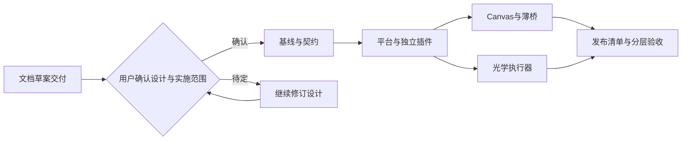

# 路线

已交付：官方Web底座、只读光学快照、近似几何/布尔、专家交互、同会话画板、显式绑定/保存、独立Tx功能试跑和Rx FOV副本扫描。

当前：平台目录分离、独立环境和两类插件Profile生命周期已落地；画板编辑器独立安装，不依赖N05源码。当前验证及剩余项见[重构总进展](../docs/refactor/2026-10-18/implementation.md)。

后续：Tx口径与采样收敛→6D耦合补偿→公差统计；Rx继续独立验证。按真实corner case迭代工具与专家反馈，不依赖最强模型兜底。

长期：画板完整随产品分发、更多模型族与仿真工具、正式发布/升级验证。范围以用户后续决策为准。

## 平台与插件重构里程碑（2026-10-18实施中）

本节限定于重构路线，不覆盖前述研究目标。用户已确认方案并授权分支实施，沙箱验证暂缓；目标方案与未决项见[设计工作簿](../docs/refactor/2026-10-18/README.md)，详细任务唯一维护于[L2计划](../.agents/plans/261018-platform-plugin-refactor.md)。

| 里程碑 | 目标 | 当前状态 | 已交付/证据 | 完成条件与剩余项 |
|---|---|---|---|---|
| M0 重构前文档 | 沉淀讨论、目标设计、图稿和计划草案 | 已完成 | [统一页面](../docs/refactor/2026-10-18/index.html)、8张已校验图与目录对照 | 本行仅指文档交付；设计确认、代码和部署均不在完成范围 |
| M1 基线与契约 | 备份盘点、五根/请求/迁移契约冻结 | 阶段完成 | 分支/基线、23项安装相关测试 | 真实资料备份、恢复与切换未做 |
| M2 平台与独立插件 | 薄启动、最小bundle、独立插件与任意cwd | 阶段完成 | 独立目录安装、任意workspace；Canvas/工作台官方Profile生命周期、坏包隔离；推荐插件安装 | Forms等组件继续收敛；完整选装/升级恢复矩阵待验 |
| M3 Canvas边界 | 独立通用文档与DSH薄桥、兼容迁移 | 部分实现 | 编辑器已有/全新本地包接入、真实iframe握手、外部workspace保存回读、Profile开关保持 | 独立Canvas通用文档协议、完整迁移与真实Agent建议闭环未完成 |
| M4 光学执行器 | 可安装入口、版本适配和跨课题实例锁 | 阶段完成 | 正式wheel含legacy/modern组件，19与2025 Web只读验收；自动环境、实例门禁；静默后台验证见回执 | 18/其他年份、旧版写入、追迹及完整研究业务待验 |
| M5 发布与目标环境 | 依赖组合、迁移演练、Windows隔离验收及说明 | 部分实现 | dev.16本地测试包、构建身份/SHA、薄EXE、市场快照、完整依赖独立安装/synthetic | 图形安装向导、签名/许可证、迁移恢复、资源分享、Sandbox/VM/公司实机待验 |

