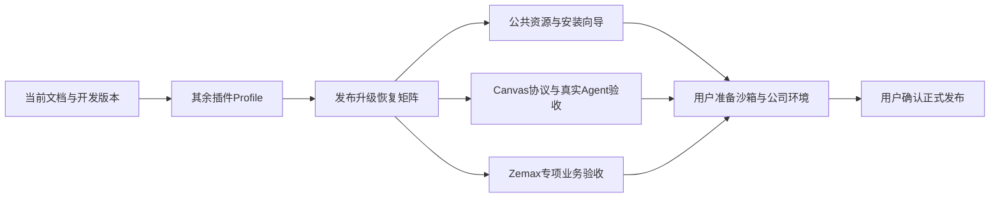

# 重构优先级与路线图

2026-10-18；当前成果与证据见[STATUS](STATUS.md)，已确认方向见[决定](../docs/decisions.md)。重构已阶段落地，尚未完成全套发布与业务验收。以下为下一阶段建议，列为待办不代表已开始实现。

## 建议推进顺序

| 优先级 | 待完成事项 | 我可以继续做的部分 | 需要葱哥配合 | 完成标准 |
|---|---|---|---|---|
| P0 本轮 | Forms原生YAML/幂等与同Run消费/dev.18 | 源码核对、三视图、归档哈希、构建及Git推送 | 已授权；不需要额外操作 | 当前入口不混历史；图/链接/版本通过；开发分支远端SHA一致 |
| P1 推荐下一块 | 其余插件统一Profile与升级恢复 | Forms已收敛；继续Experts、信息策略的实际装配盘点；逐包收敛；模拟启停/升级/卸载、关闭保持、坏包隔离 | 若涉及产品行为选择再确认；不需要真实Zemax | 所有自有插件只服从官方有效Profile，无源码/app回流，已有用户选择与资料保留 |
| P1 | 发布安装/升级/回退矩阵 | 用全新目录验证none/推荐/画板/工作台组合，缺依赖和端口冲突；从构建产物回读版本、哈希和卸载保护 | 独立目录可先做；干净Windows另见P3 | 不借源码依赖；升级失败保留Home；卸载不删用户资料；有恢复回执 |
| P2 | 公共专家/技能随包及可选.agents分享 | 公共资产白名单、各宿主适配、冲突预览、导出与隔离测试；默认包内完整能力 | 写入真实全局.agents前需另行确认；本机现状保持 | 脱离个人中心仍可用，分享不覆盖定制且可追溯 |
| P2 | 首次安装图形向导 | 程序/Home路径、组件和插件预设、依赖检测、失败诊断；复用已有安装器 | 看一轮界面与首次使用流程；按项目规则选择视觉专家 | 小白不用找JSON；升级复用原Home，无须重复配置模型 |
| P2 | Canvas真实Agent协作验收 | 当前安装版的提交/建议/拒绝反馈、断线和重复请求用合成数据验证；编排小范围真实模型验收 | 实际模型调用及交互验收按本次范围确认 | 同一官方会话闭环，草稿/提交/建议归属和失败恢复可验证 |
| P2 需先定跨仓范围 | Canvas通用文档权威与迁移协议 | 在optDSH侧整理现有协议、兼容策略和迁移草案 | 明确授权是否修改独立AgentCanvas仓库及迁移真实旧板 | 独立工具与DSH桥复用同一文档协议，不双写权威、不损失旧板 |
| P2 需宿主 | Zemax更多版本与研究业务 | 准备可复用测试、身份门禁、合成用例和对照报告 | 打开对应版本/许可证/API；提供非敏感测试副本；写入/追迹需明确范围 | 18及其他年份逐版记录；真实版本/模型身份正确，副本分析及数值对照通过 |
| P3 用户暂缓 | Sandbox→持久VM→公司实机 | 保留安装验证脚本、干净环境检查单和日志采集方案 | 准备/开启隔离环境、提供公司网络/权限/许可证条件 | 真正新机安装与恢复、公司实际业务验收，不能以分目录测试代替 |
| 发布前决策 | 正式Release、许可证及签名 | 生成可审阅清单、Release草稿与附件/哈希 | 确认开源授权、可分发资源、签名和正式发布；开发分支推送已授权 | 源码分支/标签/构建提交一致，安装包可用，无凭据/商业资料 |

**建议紧接着做P1插件生命周期。** 它直接决定用户能否自由组装、关掉功能和安全升级；可以不占用真实模型/沙箱环境先推进。之后完成发布恢复矩阵，再按使用需求安排P2。Canvas通用协议是更深的跨仓改造，不作为当前只读工作台可用性的已完成项。

## 里程碑

| 里程碑 | 目标 | 当前状态 | 已交付/证据 | 完成条件与剩余项 |
|---|---|---|---|---|
| M0 文档基线 | 当前架构、目录和需求决定可查 | 阶段完成 | [三视图](../docs/architecture/index.html)、[决定](../docs/decisions.md)、归档清单 | 后续随实际实现维护，不把旧方案当现状 |
| M1 独立平台 | 程序/Home/workspace/状态分离 | 阶段完成 | 独立安装、任意课题、Node>=24、版本/薄EXE | 正式现场切换与数据恢复演练 |
| M2 插件装配 | 官方Profile统一生命周期 | 阶段完成 | Canvas/工作台/Forms启停升级卸载、坏包隔离 | 其余自有插件、完整组合与恢复矩阵 |
| M3 Canvas边界 | 独立编辑器和通用文档薄桥 | 部分实现 | 已有/新装接入、iframe、课题保存回读 | 真实Agent协作、通用文档与迁移协议 |
| M4 光学执行器 | 可安装复用连接与版本/实例门禁 | 阶段完成 | 19/2025只读、正式legacy/modern、静默后台 | 其他年份、写入/追迹和完整研究业务 |
| M5 交付验收 | 普通用户安装与目标环境可靠运行 | 部分实现 | 本地测试包/依赖快照/独立安装/synthetic | 图形向导、公共资源、迁移恢复、沙箱/公司验收及正式发布决定 |

