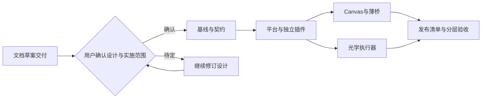

# 路线

已交付：官方Web底座、只读光学快照、近似几何/布尔、专家交互、同会话画板、显式绑定/保存、独立Tx功能试跑和Rx FOV副本扫描。

当前：模块化重整与独立光学环境，修复路径/数据/文档边界；画板N05依赖暂留。

后续：Tx口径与采样收敛→6D耦合补偿→公差统计；Rx继续独立验证。按真实corner case迭代工具与专家反馈，不依赖最强模型兜底。

长期：画板完整随产品分发、更多模型族与仿真工具、正式发布/升级验证。范围以用户后续决策为准。

## 平台与插件重构里程碑（2026-10-18实施中）

本节限定于重构路线，不覆盖前述研究目标。用户已确认方案并授权分支实施，沙箱验证暂缓；目标方案与未决项见[设计工作簿](../docs/refactor/2026-10-18/README.md)，详细任务唯一维护于[L2计划](../.agents/plans/261018-platform-plugin-refactor.md)。

| 里程碑 | 目标 | 当前状态 | 已交付/证据 | 完成条件与剩余项 |
|---|---|---|---|---|
| M0 重构前文档 | 沉淀讨论、目标设计、图稿和计划草案 | 已完成 | [统一页面](../docs/refactor/2026-10-18/index.html)、8张已校验图与目录对照 | 本行仅指文档交付；设计确认、代码和部署均不在完成范围 |
| M1 基线与契约 | 备份盘点、五根/请求/迁移契约冻结 | 阶段完成 | 分支/基线、23项安装相关测试 | 真实资料备份、恢复与切换未做 |
| M2 平台与独立插件 | 薄启动、最小bundle、独立插件与任意cwd | 阶段完成 | 新版tarball仓库外加载、core及三插件ready | React/编辑器握手与完整选装矩阵待验 |
| M3 Canvas边界 | 独立通用文档与DSH薄桥、兼容迁移 | 部分实现 | workspace新板、legacy/冲突保护 | 独立Canvas通用文档协议和完整迁移未完成 |
| M4 光学执行器 | 可安装入口、版本适配和跨课题实例锁 | 部分实现 | wheel、111项离线与无依赖synthetic | 18桥、2023+实机及全新完整依赖安装待验 |
| M5 发布与目标环境 | 依赖组合、迁移演练、Windows隔离验收及说明 | 部分实现 | 6个npm包+wheel、SHA清单/快照/说明 | 市场锁/资源、迁移、Sandbox/VM/公司实机暂缓或未验 |

