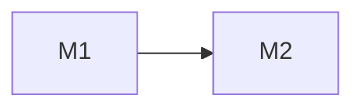

# 路线图与里程碑进度

> 固定格式：维护既有M编号和五列表，增量更新，不改成简略阶段列表或随对话换表头。实际项目替换占位，不虚构进度/日期。

更新：YYYY-MM-DD。当前目标：<本阶段交付>。计划、配置、实现、手动验证、自然触发、业务验收分别描述。

| 里程碑 | 目标 | 当前状态 | 已交付/证据 | 完成条件与剩余项 |
|---|---|---|---|---|
| M1 <名称> | <目标> | 未开始 | <真实证据或无> | <验收与剩余> |
| M2 <名称> | <目标> | 未开始 | <真实证据或无> | <验收与剩余> |

状态固定为：未开始、进行中、已完成、阻塞、后置。限定范围/已配置但未验收写在证据/剩余项列，不另造状态名。只有完成本行约定的范围和验收才标已完成；改变范围时更新完成条件，不凭已写文档标业务完成。已有编号不复用；撤销项在原行标注，不抹掉历史。

## 开发依赖

根据真实依赖修改Mermaid代码，不用图片替代；不编造研发日期。依赖图是辅助，状态表始终保留。

## 当前下一步

<当前可开始的里程碑、下一步交付，以及必要前置条件。>

## 未决问题

<只记录真实未决项；没有则写无。>
